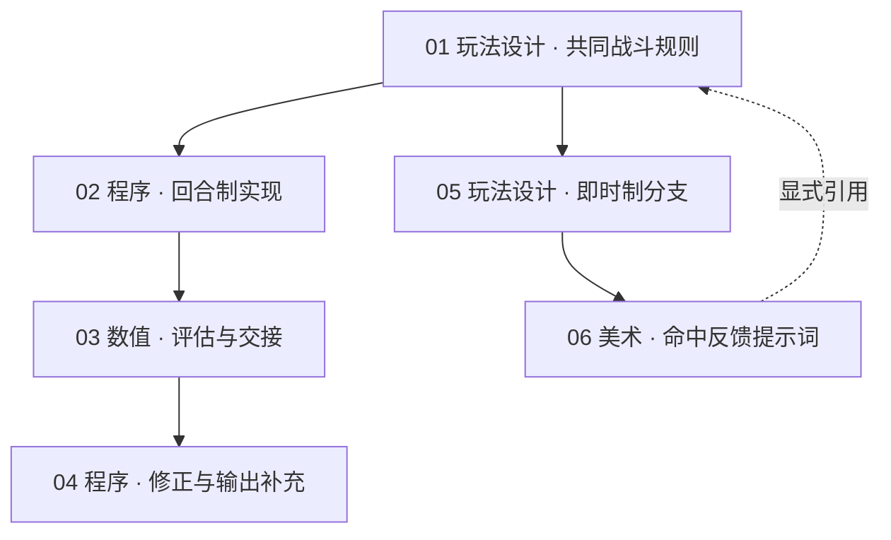
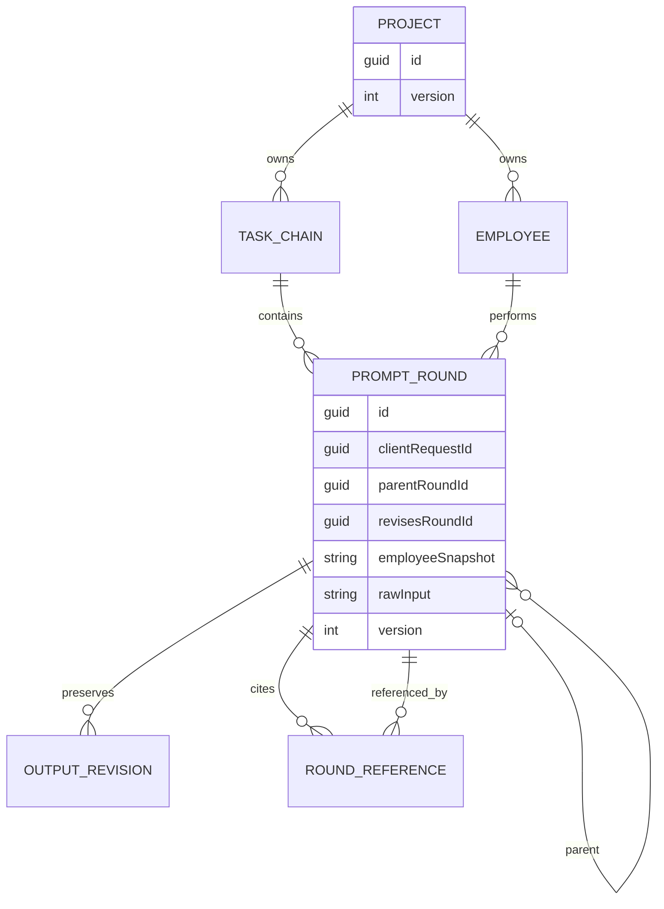

# PromptCrew · AI 虚拟员工提示词管理器

**像组织团队一样管理 AI 员工，让每一轮提示词、交接和修订都有迹可循。**

[](https://github.com/jayhuangsci/HabitTracker/actions/workflows/promptcrew.yml)


一个项目可以有玩法设计师、程序员、美术设计师和数值策划，也可以由用户配置其他角色。一条任务链对应具体任务，员工依次接手；每轮输入、员工基础提示词快照、输出版本和成果引用都可追溯。

本仓库由 **HabitTracker / FORM** 演进而来，复用 C# MVVM 与界面基础。原训练应用、OpenSilver 客户端和训练数据继续保留，使用说明见[原业务文档](docs/legacy-fitness.md)。PromptCrew 使用独立数据库。

## 三分钟体验

需要 **Windows 10/11、.NET 10 SDK、PowerShell 7**。

```powershell
git clone --branch codex/promptcrew https://github.com/jayhuangsci/HabitTracker.git
cd HabitTracker
./scripts/Start-PromptCrew.ps1 -Demo
```

演示创建“星港”游戏项目、四名员工和六轮记录：



1. 点击“战斗系统原型”的任一节点，在“记录与输出”查看原始输入、角色快照与输出历史。
2. 选中第一轮，点“从此轮继续”，选择另一名员工，输入提示词并保存，即形成新分支。
3. 在“记录与输出”补充结果；再次保存会追加版本。“修订输入”会创建新记录并保留原文。
4. 在“分支上下文”生成祖先链与显式引用；在“版本对比”和“搜索”检查历史。
5. 关闭后重新启动，记录与本机草稿恢复。完整[演示与验证流程](docs/promptcrew-demo.md)。

自己的项目使用：

```powershell
./scripts/Start-PromptCrew.ps1
# 默认端口占用时：
./scripts/Start-PromptCrew.ps1 -Port 5285
```

正式工作区首次为空，可用界面的“＋”创建项目、员工与任务链；员工编辑器提供四个角色模板。关闭桌面会停止该启动器创建的 API。已有服务不会被替换。

## 已实现的功能

| 能力 | 实际行为 |
| --- | --- |
| 项目与团队 | 项目背景、约束、状态；自定义员工职责、基础提示词、Skills；任务目标与完成标准 |
| 提示词链 | 单父节点、分支、跨员工交接、同项目跨任务链引用；原始输入和角色快照保留 |
| 历史与复用 | 输入修订新建记录；输出追加版本；复制、正文/员工/标签/状态搜索、逐行对比 |
| 上下文 | 按当前父节点向上取祖先，并合并明确引用；兄弟分支不会自动混入 |
| 幂等与并发 | 输入及输出请求 ID 去重；同 ID 不同内容返回 409；更新须匹配版本号 |
| 项目隔离 | API Key 可限制项目；归属校验及数据库复合外键；支持撤销密钥 |
| 桌面恢复 | 独立 SQLite；本机草稿与待确认请求持久化；断线重试沿用原请求 |
| Agent 工具 | 可执行 C# HTTP 工具、函数定义、可安装 Skill、OpenAPI 与完整调用演示 |

第一阶段提供记录与协作管理。**不内置模型推理、多 Agent 自动调度、云同步或 MCP 服务。** Skills 字段保存关联名称，不会自动下载或执行 Skill。

## 让 Agent 保存实际任务

保持 API 运行，在桌面“API Key”中签发仅能访问指定项目的密钥，保存到仓库外的文件。

```powershell
$env:PROMPTCREW_API_URL = 'http://127.0.0.1:5283/'
$env:PROMPTCREW_KEY_FILE = 'C:/my-secrets/promptcrew-agent.key'
$env:PROMPTCREW_TOOLS_DLL = (Resolve-Path 'src/PromptCrew.Tools/bin/Release/net10.0/PromptCrew.Tools.dll').Path

'{"operation":"list_projects"}' | Set-Content .local/list-projects.json -Encoding utf8NoBOM
dotnet $env:PROMPTCREW_TOOLS_DLL invoke .local/list-projects.json
```

启动脚本已创建 `.local` 演示目录；独立调用前可用 `New-Item -ItemType Directory .local -Force` 创建请求文件目录。

工具成功返回 `ok: true`。写入请求先保存到 JSON 文件，失败后用同一文件和同一 `clientRequestId` 重试。Agent 保存时还需提交实际采用的 `expectedEmployeeVersion`；员工定义变化会报冲突。

- [Agent 配置、Skill 安装与云端访问](docs/promptcrew-agent.md)
- [Skill 工作流](skills/promptcrew-journal/SKILL.md) · [函数定义](tools/promptcrew.function.json)
- [API、请求字段与调用示例](docs/promptcrew-api.md)

独立运行 API（Windows / Linux / macOS，需 .NET 10 SDK）：

```powershell
dotnet run --project src/PromptCrew.Api
```

默认监听 `http://127.0.0.1:5283`，开发模式文档位于 [Swagger](http://127.0.0.1:5283/swagger)。首次启动生成管理员密钥文件，不在控制台打印。默认只绑定本机；云端 Agent 需要可达的 HTTPS 地址和配置在宿主中的项目密钥，详见接入文档。

## 数据与 C# 实现



| 工程 | 职责 |
| --- | --- |
| `PromptCrew.Core` | C# records、契约、枚举、校验与有界文本差异；不引用 WPF 或 EF |
| `PromptCrew.Api` | Minimal API、项目权限、EF Core 迁移、事务性保存、幂等与并发处理 |
| `PromptCrew.Client` | WPF 和工具共享的类型化 HTTP 客户端与错误处理 |
| `PromptCrew.Desktop` | WPF/MVVM、树状轮次、草稿恢复；链接复用原命令和基础主题 |
| `PromptCrew.Tools` | 将 JSON 函数参数映射为真实 HTTP 调用；宿主负责提供密钥 |

具体复用决策、并发与时间处理见[实现说明](docs/promptcrew-architecture.md)。

| 数据 | 默认位置 |
| --- | --- |
| 正式记录与管理员密钥 | `%LOCALAPPDATA%/PromptCrew/personal/promptcrew.db`、`admin.key` |
| 源码演示记录 | `.local/promptcrew-demo/` |
| 源码启动器草稿 | 对应数据目录内的 `desktop-settings.json` |
| 单独启动桌面的草稿 | `%LOCALAPPDATA%/PromptCrew/desktop-settings.json` |
| 原训练数据 | 原路径保留，新应用不会读取或迁移 |

原始输入不可原地修改，父节点仅在创建时指定，因此不能由正常 API 构造循环。输出和备注修正通过追加结果保留历史。时间以 UTC 持久化，桌面按本机时区显示；链内顺序使用服务器分配的序号，避免依赖客户端时钟。

## 验证与打包

```powershell
dotnet test PromptCrew.slnx -c Release
./scripts/Test-PromptCrewAgent.ps1
./scripts/Publish-PromptCrew.ps1 -SelfContained
```

- **23 个 API 集成测试 + 1 个 WPF 工作流测试**：真实 SQLite，覆盖项目隔离、链路合法性、分支引用、重复请求、并发冲突、角色快照、版本保留、停止服务后的恢复，以及响应丢失后重试。
- Agent 演示通过真实 CLI → HTTP → SQLite 创建四名员工、六轮交接与分支，并检查重放、冲突和上下文边界。
- 打包生成 `artifacts/PromptCrew-win-x64.zip`；解压后用 PowerShell 7 运行 `./Run.ps1 -Demo`。自包含包无需安装 .NET。
- [交付记录及各批限制](docs/promptcrew-delivery.md)；GitHub Actions 同时检查新产品与保留的原业务。

当前按单机使用设计。搜索使用 SQLite 正文过滤；对比保留共同前后文后显示中段替换，不保证最短差异。祖先链上限 256 轮、上下文上限 500,000 字符、每页最多 200 条；长任务可拆链并引用成果。API Key 只有项目范围，暂未细分只读/写入权限；本地数据库、草稿和密钥文件依赖操作系统权限保护，不提供应用级加密。
