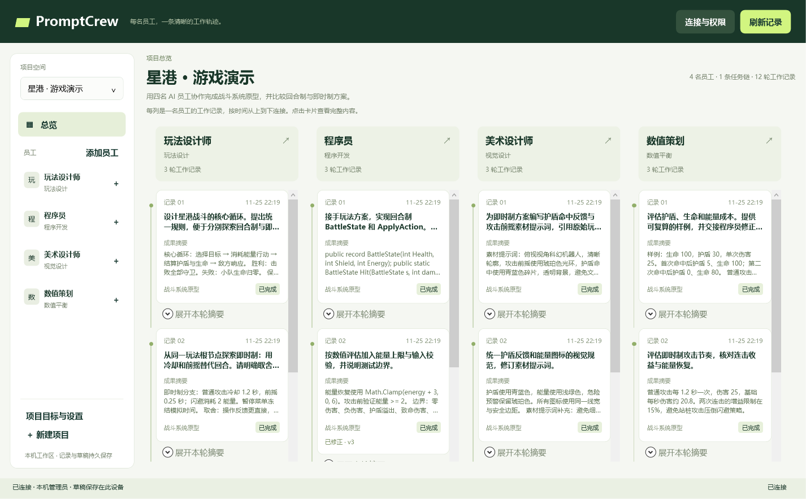
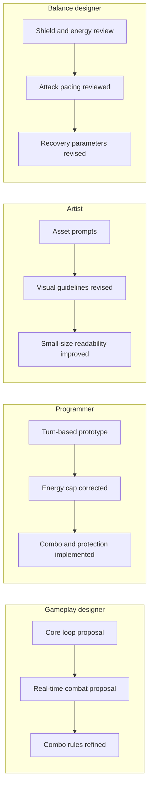
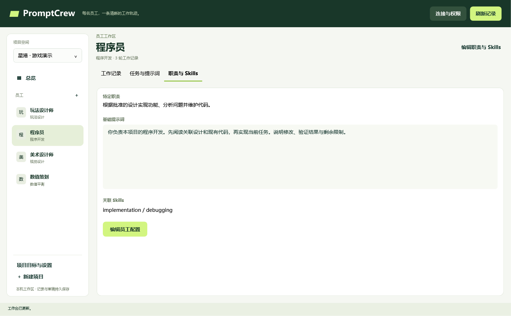
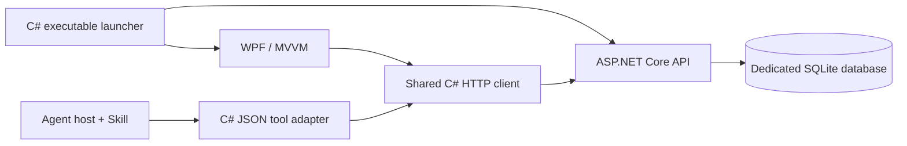
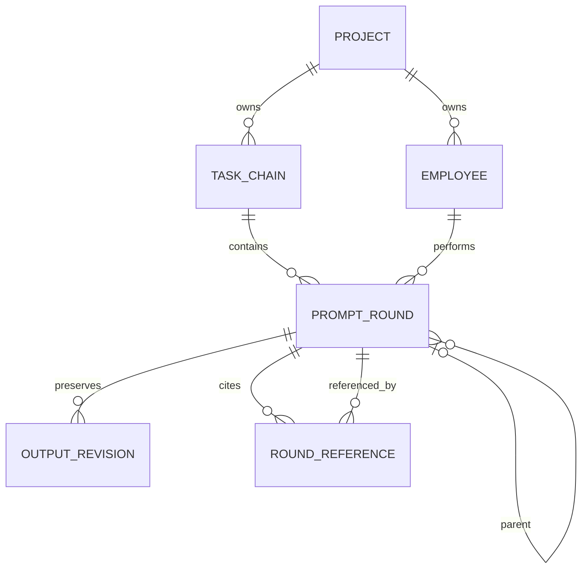

# PromptCrew · AI Employee Prompt Manager

**A C# workspace for your AI team's prompts, results, and development history.**

[](https://github.com/jayhuangsci/HabitTracker/actions/workflows/promptcrew.yml)


[Run on Windows](#windows) · [Three-minute walkthrough](#demo) · [Connect an Agent](#agent) · [Implementation and validation](#engineering)



PromptCrew organizes AI work by project, employee, and task. Define roles such as gameplay designer, programmer, artist, or balance designer, then keep the actual prompts, model outputs, and artifact references from each round of work.

The overview gives **each employee a separate vertical history**. Select an employee to open their workspace, or select a history card to inspect the full input, role snapshot, output revisions, and context.

The application handles recording and organization. The Agent host runs models and coordinates execution; PromptCrew receives records through its HTTP API and companion Skill.

**Language:** the desktop UI and demo prompts currently use Simplified Chinese. This README uses English translations of the UI labels. Linked implementation guides and the Skill are currently in Chinese.

<a id="windows"></a>
## Run the Windows app

**The portable package runs on Windows 10/11 x64. No .NET installation, SDK, or PowerShell 7 is required.**

1. Open [GitHub Actions](https://github.com/jayhuangsci/HabitTracker/actions/workflows/promptcrew.yml) and select the latest successful build of `main`.
2. Under **Artifacts**, download `PromptCrew-win-x64` and extract it. If the download contains another ZIP with the same name, extract that inner ZIP too.
3. Open the folder containing the following executables and double-click one:

| Executable | Purpose |
| --- | --- |
| **`PromptCrew-Demo.exe`** | Game project demo with four employees and three rounds per employee |
| **`PromptCrew.exe`** | Your own workspace; create a project on first launch |

The launcher starts the local service and desktop app, then stops its service when the desktop closes. Keep the `api`, `desktop`, and `tools` folders beside the executables.

```text
PromptCrew-win-x64/
├─ PromptCrew.exe
├─ PromptCrew-Demo.exe
├─ api/
├─ desktop/
├─ tools/
├─ promptcrew-journal/
└─ promptcrew.function.json
```

A local build produces `artifacts/PromptCrew-win-x64/` and `artifacts/PromptCrew-win-x64.zip`. Downloading Actions artifacts generally requires a GitHub account.

<a id="demo"></a>
## Three-minute walkthrough

A fresh demo creates a spaceport game project with **4 employees, 12 recorded rounds, output corrections, and gameplay branches**. The screenshots use an isolated demo database. Existing workspaces do not receive additional sample records automatically.

**Lines in the overview connect successive records from the same employee.** Each card comes from persisted data and shows a prompt or result excerpt, timestamp, task, and status:



1. **Browse Overview.** Read what each employee worked on and how their work changed. Excerpts come directly from the original text.
2. **Select an employee.** Open Work History, Tasks & Prompts, or Responsibilities & Skills, and see the tasks they contributed to.
3. **Open a card.** Read the complete prompt and output. Expand the saved base prompt snapshot or record metadata.
4. **Continue the work.** Continue from a historical node, or revise an input by creating a new round. Output corrections append a revision.
5. **Inspect context.** Retrieve the selected record's ancestors and explicit references, or compare two output revisions from the same round.
6. **Return and resume.** Overview restores your browsing position. Employees have separate drafts, and saved work remains available after a restart.


<details>
<summary>More screenshots: complete records, employee configuration, and revision comparison</summary>





</details>

The overview is a chronological reading view. Actual task parents, branches, input revisions, and references between tasks remain intact and are available in task details. See the [full demo walkthrough](docs/promptcrew-demo.md).

## Run from source

Requires Windows 10/11 and the **.NET 10 SDK**. The source launcher works with Windows PowerShell 5.1:

```powershell
git clone --branch main https://github.com/jayhuangsci/HabitTracker.git
cd HabitTracker
.\Start-PromptCrew-Demo.cmd
```

For your own workspace, double-click `Start-PromptCrew.cmd`. To choose a port:

```powershell
.\Start-PromptCrew.cmd -Port 5285
```

The portable executable tries port 5283 and selects an available port if it is occupied. The source launcher accepts `-Port`. Maintenance scripts for Agent verification and packaging use PowerShell 7.

## Implemented features

| Capability | Behavior |
| --- | --- |
| Projects and employees | Project background, constraints, and state; employee responsibilities, base prompts, Skills, and role templates |
| Employee history | A separate chronological card chain for each employee, spanning tasks, with full records loaded on demand |
| Task chains | One parent per round, branches, employee handoffs, and references between tasks in the same project |
| Input preservation | Original inputs and employee definition snapshots remain available; input edits create linked rounds |
| Output revisions | Results and corrections append history; compare v2/v3 of one round or text from different rounds |
| Search and context | Search by employee, task, tag, status, and text; retrieve ancestors and explicitly referenced work |
| Safe retries | Request IDs deduplicate input and result writes; reusing an ID with different content returns HTTP 409 |
| Concurrency and isolation | Version checks prevent silent overwrites; project-scoped API Keys, ownership validation, and key revocation |
| Desktop recovery | Separate employee drafts, persisted pending requests, legacy draft migration, and restart recovery |
| Agent integration | Executable C# HTTP tools, function definitions, a Skill, OpenAPI, and runnable examples |

<a id="agent"></a>
## Let an Agent record its work

1. Keep the app open. Under **Connection & Permissions → API Key & Project Permissions**, issue a project-scoped key and save it outside the repository.
2. Configure the API address and key file in the Agent host. The portable app writes its current address to the workspace's `connection.json`.
3. Load the [companion Skill](skills/promptcrew-journal/SKILL.md), or register the [function definition](tools/promptcrew.function.json).

A recorded task follows this sequence:

```text
Resolve project, employee, and task → retrieve ancestors and references → save actual input
→ execute the task → append visible output and artifact references → return the record ID
```

After building from source, run this example from the repository root in PowerShell 7:

```powershell
$env:PROMPTCREW_API_URL = 'http://127.0.0.1:5283/'
$env:PROMPTCREW_KEY_FILE = 'C:/my-secrets/promptcrew-agent.key'
$env:PROMPTCREW_TOOLS_DLL = (Resolve-Path 'src/PromptCrew.Tools/bin/Release/net10.0/PromptCrew.Tools.dll').Path

New-Item -ItemType Directory .local -Force | Out-Null
'{"operation":"list_projects"}' | Set-Content .local/list-projects.json -Encoding utf8NoBOM
dotnet $env:PROMPTCREW_TOOLS_DLL invoke .local/list-projects.json
```

The portable package also includes `tools/PromptCrew.Tools.exe invoke <request-file>`. The tool returns `ok: true` only after the service confirms success. Failures retain the request ID and file location. Retry with the original file; Agent writes also include the employee definition version actually used.

- [Agent setup, Skill installation, and remote access](docs/promptcrew-agent.md)
- [API routes, payloads, and working examples](docs/promptcrew-api.md)
- [Skill tool contract](skills/promptcrew-journal/references/tool-contract.md)

The API can run independently on Windows, Linux, or macOS:

```powershell
dotnet run --project src/PromptCrew.Api
```

Development-mode documentation is available at [local Swagger](http://127.0.0.1:5283/swagger). A cloud Agent needs a reachable HTTPS endpoint and project credentials supplied by its host; the default service listens locally. Linked Skills store configuration names, and execution depends on the host's tools and permissions.

<a id="engineering"></a>
## C# implementation



| Project | Responsibility |
| --- | --- |
| `PromptCrew.Core` | Record contracts, enums, validation, and bounded text comparison, without WPF or EF dependencies |
| `PromptCrew.Api` | Project permissions, EF Core migrations, input snapshots, appended results, idempotency, and optimistic concurrency |
| `PromptCrew.Client` | Typed HTTP calls and error handling shared by the desktop and tools |
| `PromptCrew.Desktop` | Employee histories, task details, role configuration, drafts, and recovery |
| `PromptCrew.Launcher` | Service startup, port selection, authenticated readiness checks, and shutdown |
| `PromptCrew.Tools` | JSON arguments mapped to real HTTP calls, with credentials supplied by the host |

Overview uses a lightweight query for input and latest-output previews, then loads complete records on demand. Composite foreign keys enforce project ownership for employees, tasks, parents, and references. Inputs and parent links are fixed after creation; revised inputs create records, and corrected outputs append revisions. The service stores UTC timestamps, while the desktop displays local time.



See the [implementation notes](docs/promptcrew-architecture.md) for code reuse, write transactions, version conflicts, and context handling.

## Validation and packaging

**75 automated tests passed: 25 PromptCrew API tests, 1 WPF workflow test, and 49 tests for the preserved fitness application.**

| Verification | Coverage |
| --- | --- |
| API with real SQLite | Project isolation, valid chains, duplicate requests, concurrency conflicts, role snapshots, output history, and service restarts |
| Actual WPF button bindings | Employee and card navigation, context across tasks, overview position recovery, isolated drafts, and legacy pending requests |
| Agent tool demo | 31 CLI/HTTP calls creating 4 employees and 6 handoff rounds, checking branches, replay, conflicts, and historical comparisons |
| Portable package checks | Personal and demo executables, occupied ports, authentication, desktop rendering, service shutdown, and incomplete-package errors |

```powershell
dotnet test PromptCrew.slnx -c Release
dotnet test HabitTracker.slnx -c Release
./scripts/Test-PromptCrewAgent.ps1
./scripts/Publish-PromptCrew.ps1 -SelfContained
./scripts/Test-PromptCrewPackage.ps1 -PackageDirectory artifacts/PromptCrew-win-x64
```

[GitHub Actions](https://github.com/jayhuangsci/HabitTracker/actions/workflows/promptcrew.yml) checks PromptCrew on Windows and Linux and produces a self-contained Windows package. The [delivery log](docs/promptcrew-delivery.md) records completed batches and their verification.

## Storage and current limits

| Data | Default location |
| --- | --- |
| Personal records | `%LOCALAPPDATA%/PromptCrew/personal/` |
| Portable demo records | `%LOCALAPPDATA%/PromptCrew/demo/` |
| Source demo records | `.local/promptcrew-demo/` |
| Drafts, keys, and connection information | The launcher's corresponding data directory |
| Drafts when starting the desktop alone | `%LOCALAPPDATA%/PromptCrew/desktop-settings.json` |

The current design targets personal use on one machine. Overview loads all lightweight project summaries; search pages contain up to 200 records. Context is limited to 256 ancestors and 500,000 compiled characters. Text comparison shows shared context and the replaced section without guaranteeing the shortest edit sequence. Project keys allow reads and writes within their scope; read-only permissions are not yet available. Local files rely on operating-system access controls.

## Repository history

This repository evolved from **HabitTracker / FORM**, a strength-training journal. PromptCrew reuses its MVVM commands, base theme, and testing approach. The original WPF and OpenSilver fitness apps, source, and data remain available, while the new business uses separate storage. See the [HabitTracker / FORM documentation](docs/legacy-fitness.md).
