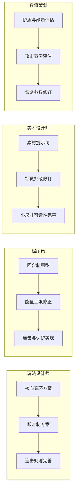
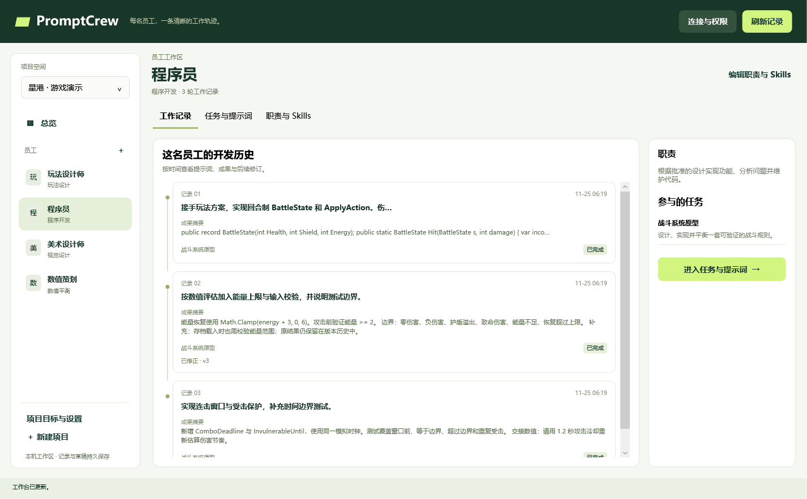
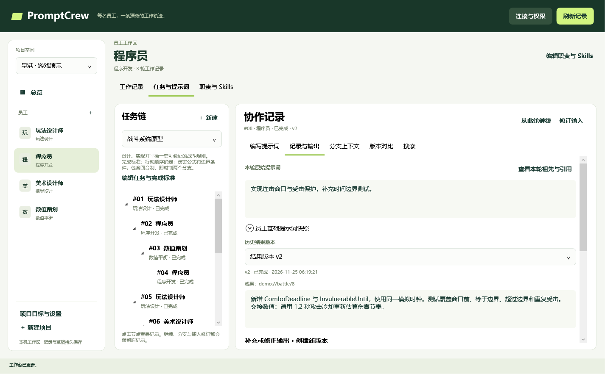
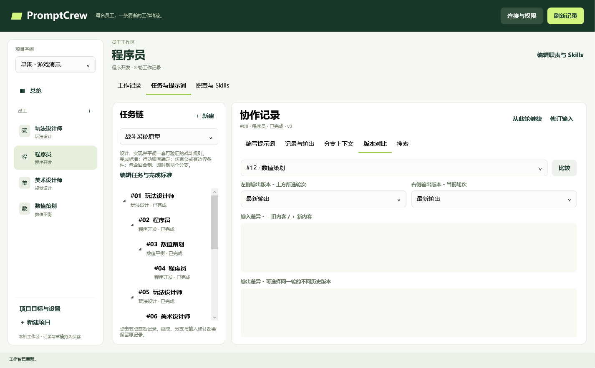
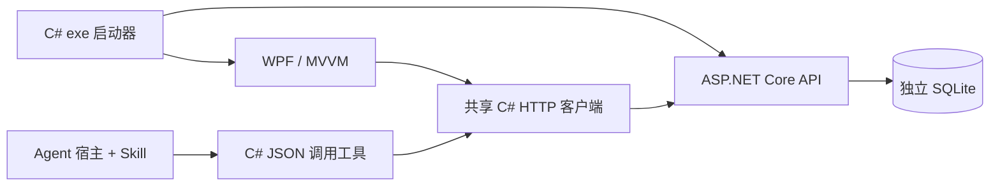
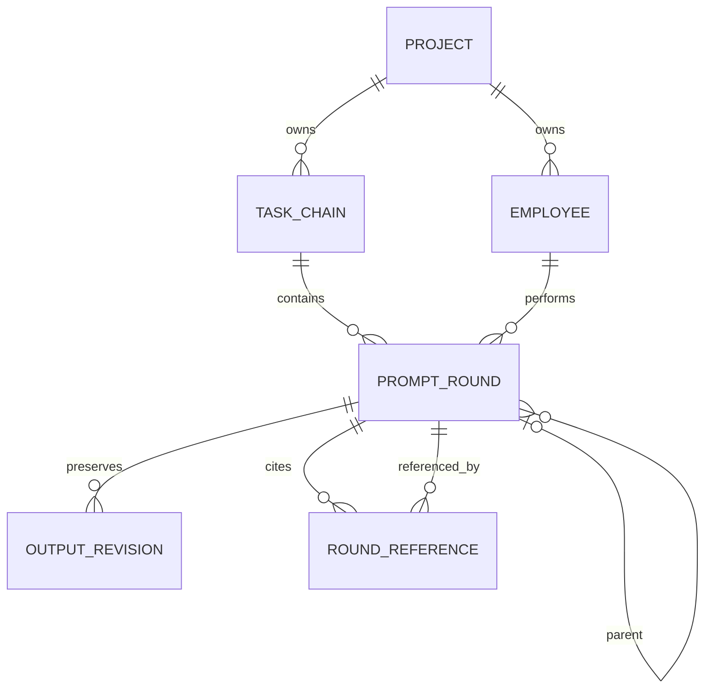

# PromptCrew · AI 虚拟员工提示词管理器

**按员工看开发历史，按任务追踪提示词，让每一轮输入、成果和修订都能找回来。**

[](https://github.com/jayhuangsci/HabitTracker/actions/workflows/promptcrew.yml)


[运行 Windows 版](#windows) · [三分钟体验](#demo) · [接入 Agent](#agent) · [实现与验证](#engineering)


PromptCrew 是用 C# 实现的 AI 团队工作记录工具。你可以为项目配置玩法设计师、程序员、美术设计师、数值策划，也可以自定义其他角色，并保存他们每轮实际使用的提示词、模型输出和成果引用。

默认总览把**每名员工的多轮工作记录**串成独立的纵向卡片链。点击员工进入其工作区；点击卡片查看完整输入、角色快照、输出历史和上下文。

当前实现提示词记录与协作管理。模型执行和多个 Agent 的自动调度由宿主负责；应用通过 HTTP API 和配套 Skill 接收记录。

<a id="windows"></a>
## 直接运行 Windows 版

**便携版适用于 Windows 10/11 x64，无需安装 .NET、SDK 或 PowerShell 7。**

1. 打开 [GitHub Actions 构建页面](https://github.com/jayhuangsci/HabitTracker/actions/workflows/promptcrew.yml)，选择 `main` 分支最近一次成功构建。
2. 在 **Artifacts** 下载 `PromptCrew-win-x64`，解压到自己的目录。若解压后得到同名 ZIP，再解压内层 ZIP。
3. 在包含下列 exe 的目录中双击启动：

| 入口 | 用途 |
| --- | --- |
| **`PromptCrew-Demo.exe`** | 游戏项目演示：四名员工，每人三轮历史 |
| **`PromptCrew.exe`** | 自己的正式工作区，首次打开可创建项目 |

程序会自动启动本地服务和桌面，关闭界面后停止它创建的服务。请保留 exe 旁的 `api`、`desktop` 和 `tools` 文件夹。

```text
PromptCrew-win-x64/
├─ PromptCrew.exe
├─ PromptCrew-Demo.exe
├─ api/
├─ desktop/
├─ tools/
├─ promptcrew-journal/
└─ promptcrew.function.json
```

源码打包后的程序目录为 `artifacts/PromptCrew-win-x64/`，压缩包为 `artifacts/PromptCrew-win-x64.zip`。GitHub 下载构建产物通常需要登录。

<a id="demo"></a>
## 三分钟看懂工作流程

首次创建演示时，会保存“星港”游戏项目的 **4 名员工、12 轮记录、输出修正和玩法分支**。截图使用独立演示库；已有工作区不会自动追加样例。

**总览中的连线表示同一员工记录的时间先后。** 每张卡片来自真实持久化记录，展示提示词或成果摘要、时间、任务和状态：



1. **看总览**：浏览每名员工做过什么，以及后续如何完善。摘要直接截取原文。
2. **点员工**：进入“工作记录”“任务与提示词”“职责与 Skills”，查看该员工参与的任务。
3. **点卡片**：阅读完整原始输入和输出；展开员工基础提示词快照及记录信息。
4. **继续工作**：从历史节点继续，或修订输入生成新轮次；补充输出会追加结果版本。
5. **核对上下文**：查看本轮祖先与显式引用，或比较同一轮的两个输出版本。
6. **返回与恢复**：回到总览保留浏览位置；切换员工分别保留草稿，重启后继续编辑。



<details>
<summary>展开查看：完整记录、职责配置与版本对比</summary>






</details>

总览的时间连线是阅读方式。实际任务的父节点、分支、输入修订和跨任务引用保存在原数据关系中，在任务详情查看。完整步骤见 [游戏项目验收](docs/promptcrew-demo.md)。

## 从源码运行

需要 Windows 10/11 和 **.NET 10 SDK**。源码启动入口兼容 Windows 自带的 PowerShell 5.1：

```powershell
git clone --branch main https://github.com/jayhuangsci/HabitTracker.git
cd HabitTracker
.\Start-PromptCrew-Demo.cmd
```

自己的工作区双击 `Start-PromptCrew.cmd`。需要指定端口时：

```powershell
.\Start-PromptCrew.cmd -Port 5285
```

便携 exe 默认尝试 5283，端口占用时会寻找空闲端口；源码启动器可通过 `-Port` 指定端口。Agent 验收和打包等维护脚本使用 PowerShell 7。

## 已实现的能力

| 能力 | 行为 |
| --- | --- |
| 项目与员工 | 项目背景、约束与状态；员工职责、基础提示词、Skills 和角色模板 |
| 员工历史 | 每人独立的时间顺序卡片链；跨任务汇总，按需打开完整记录 |
| 任务链 | 单父节点、分支、跨员工交接，以及同项目跨任务引用 |
| 输入保留 | 原始输入和员工定义快照保留；修改输入形成新轮次并关联原记录 |
| 输出版本 | 补充和修正均追加历史；支持同轮 v2/v3 和跨轮次文本对比 |
| 搜索与上下文 | 按员工、任务、标签、状态和正文检索；取祖先链及明确引用 |
| 安全重试 | 输入与结果使用请求 ID 去重；同 ID 不同内容返回 409 |
| 并发与隔离 | 版本号防止静默覆盖；项目范围 API Key、归属校验和撤销 |
| 桌面恢复 | 员工独立草稿、待确认请求持久化、旧草稿兼容和重启恢复 |
| Agent 接入 | C# HTTP 工具、函数定义、Skill、OpenAPI 与可执行示例 |

<a id="agent"></a>
## 让 Agent 保存实际工作

1. 保持应用打开，在 **连接与权限 → API Key 与项目权限** 为 Agent 签发项目范围密钥，保存到仓库外。
2. 将 API 地址和密钥文件路径配置到 Agent 宿主。便携版当前地址可在工作区的 `connection.json` 查看。
3. 加载 [配套 Skill](skills/promptcrew-journal/SKILL.md)，或注册 [函数定义](tools/promptcrew.function.json)。

Agent 的记录顺序为：

```text
确认项目、员工和任务 → 获取祖先及引用上下文 → 保存实际输入
→ 执行当前任务 → 追加可见输出与成果引用 → 返回记录 ID
```

以下是从源码构建后的工具调用示例，在仓库根目录使用 PowerShell 7：

```powershell
$env:PROMPTCREW_API_URL = 'http://127.0.0.1:5283/'
$env:PROMPTCREW_KEY_FILE = 'C:/my-secrets/promptcrew-agent.key'
$env:PROMPTCREW_TOOLS_DLL = (Resolve-Path 'src/PromptCrew.Tools/bin/Release/net10.0/PromptCrew.Tools.dll').Path

New-Item -ItemType Directory .local -Force | Out-Null
'{"operation":"list_projects"}' | Set-Content .local/list-projects.json -Encoding utf8NoBOM
dotnet $env:PROMPTCREW_TOOLS_DLL invoke .local/list-projects.json
```

便携包也提供 `tools/PromptCrew.Tools.exe invoke <请求文件>`。工具只在服务确认成功后返回 `ok: true`；失败会保留请求 ID 和文件位置。重试使用原文件，Agent 保存时携带实际采用的员工定义版本。

- [Agent 配置、Skill 安装与云端访问](docs/promptcrew-agent.md)
- [API 路由、请求字段和实际调用示例](docs/promptcrew-api.md)
- [Skill 工具载荷](skills/promptcrew-journal/references/tool-contract.md)

API 可独立跨平台运行：

```powershell
dotnet run --project src/PromptCrew.Api
```

开发模式的文档位于 [本机 Swagger](http://127.0.0.1:5283/swagger)。云端 Agent 需要宿主提供可达的 HTTPS 地址和项目凭据；默认服务绑定本机。关联 Skills 保存配置名称，具体执行由具备权限和工具的宿主完成。

<a id="engineering"></a>
## C# 实现



| 工程 | 具体职责 |
| --- | --- |
| `PromptCrew.Core` | records 契约、枚举、校验和有界文本差异，不引用 WPF 或 EF |
| `PromptCrew.Api` | 项目权限、EF Core 迁移、输入快照、结果追加、幂等和乐观并发 |
| `PromptCrew.Client` | 桌面与工具共享类型化 HTTP 调用和错误处理 |
| `PromptCrew.Desktop` | 员工历史总览、任务详情、职责配置、员工草稿与恢复 |
| `PromptCrew.Launcher` | 服务启动、端口选择、认证就绪检查及退出清理 |
| `PromptCrew.Tools` | 将 JSON 参数映射为真实 HTTP 调用，凭据由宿主注入 |

总览通过轻量查询读取输入和最新输出预览，完整记录按需加载。数据库复合外键校验员工、任务、父节点和引用归属。轮次创建后不修改输入与父节点；输入修订另建记录，输出修正追加版本。保存时间使用服务端 UTC，界面按本机时区显示。



具体复用决策、写入事务、版本冲突和上下文处理见 [实现说明](docs/promptcrew-architecture.md)。

## 验证与打包

**75 个自动化测试通过：25 个 PromptCrew API 测试、1 个 WPF 工作流测试，以及保留的原业务 49 个测试。**

| 验证方式 | 实际覆盖 |
| --- | --- |
| API + 真实 SQLite | 项目隔离、链路合法性、重复请求、并发冲突、角色快照、输出历史和服务重启 |
| WPF 实际按钮绑定 | 员工/卡片导航、跨任务上下文、总览位置恢复、草稿隔离及旧请求恢复 |
| Agent 工具演示 | 31 次 CLI/HTTP 调用，创建 4 名员工和 6 轮交接，验证分支、重放、冲突及历史对比 |
| 便携包验证 | 正式/演示 exe、端口避让、认证、桌面渲染、服务退出和不完整包提示 |

```powershell
dotnet test PromptCrew.slnx -c Release
dotnet test HabitTracker.slnx -c Release
./scripts/Test-PromptCrewAgent.ps1
./scripts/Publish-PromptCrew.ps1 -SelfContained
./scripts/Test-PromptCrewPackage.ps1 -PackageDirectory artifacts/PromptCrew-win-x64
```

[GitHub Actions](https://github.com/jayhuangsci/HabitTracker/actions/workflows/promptcrew.yml) 在 Windows 和 Linux 检查新产品，并生成自包含 Windows 包。各批次的完成情况与验证记录见 [交付记录](docs/promptcrew-delivery.md)。

## 数据位置与当前边界

| 内容 | 默认位置 |
| --- | --- |
| 正式记录 | `%LOCALAPPDATA%/PromptCrew/personal/` |
| 便携版演示记录 | `%LOCALAPPDATA%/PromptCrew/demo/` |
| 源码演示记录 | `.local/promptcrew-demo/` |
| 草稿、密钥及连接信息 | 启动器对应的数据目录 |
| 单独启动桌面的草稿 | `%LOCALAPPDATA%/PromptCrew/desktop-settings.json` |

当前适合单机使用。总览一次读取项目全部轻量摘要；搜索每页最多 200 条；祖先链最多 256 轮、编译上下文最多 500,000 字符。文本对比显示共同前后文与中间替换，不保证最短编辑序列。项目密钥具有授权项目的读写权限，暂无只读权限；本地文件依赖操作系统访问权限保护。

## 仓库沿革

本仓库由 **HabitTracker / FORM** 训练记录项目演进而来，复用原 MVVM 命令、基础主题和测试方式。原 WPF / OpenSilver 训练应用、源码及数据继续保留，新业务使用独立存储。原业务说明见 [HabitTracker / FORM 文档](docs/legacy-fitness.md)。
