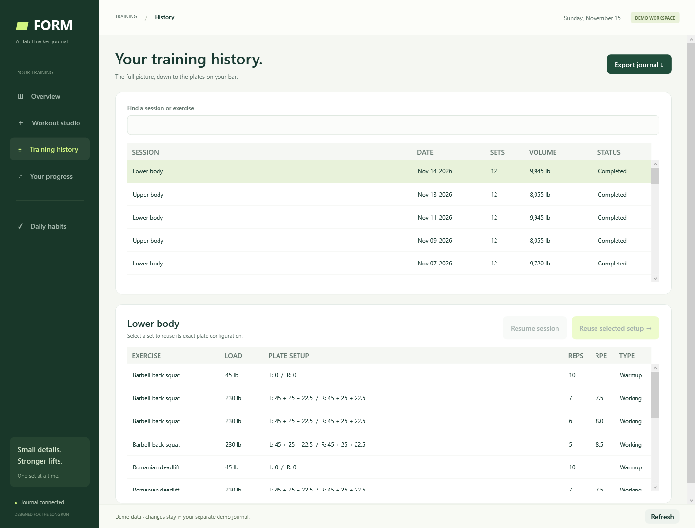
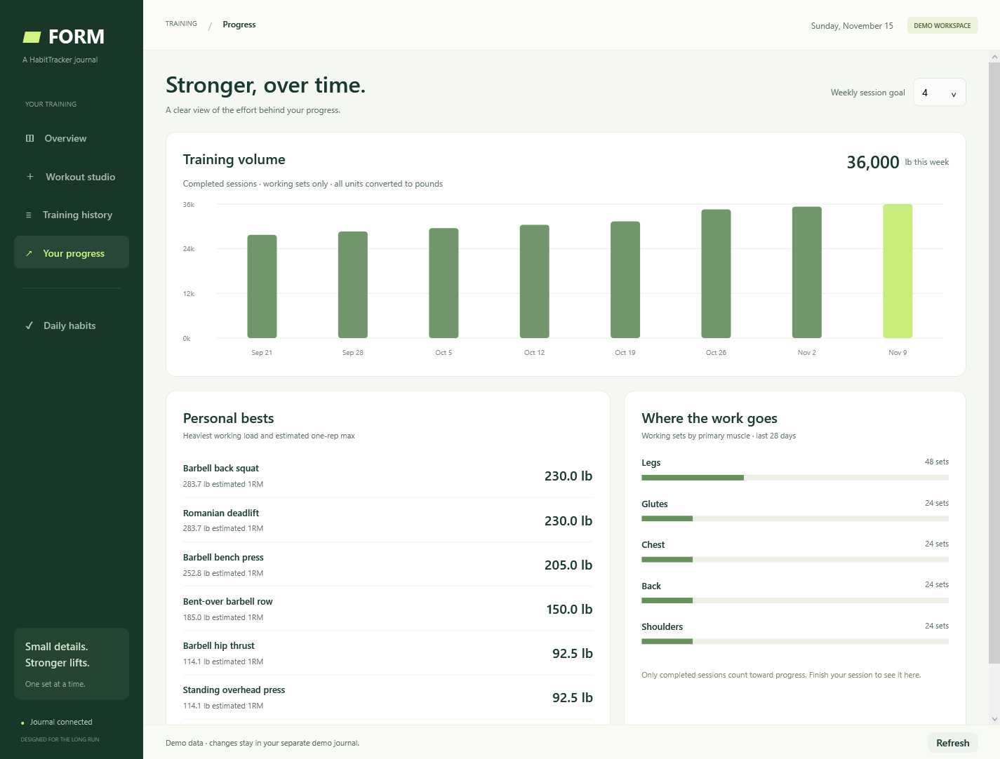

# A three-minute demonstration

## Start

Run `./scripts/Start-Demo.ps1` from the repository root in PowerShell 7. The first run builds the app and seeds eight weeks of synthetic sessions. Existing demo data is retained on later runs. The source demo database is `.local/demo.db`; the personal source database is separate.

## Show the differentiator

1. On **Overview**, point out working-set volume, weekly consistency and the recent journal.
2. Open **Workout studio**. With pounds and a 45 lb bar, type `45lbs+25lbs+10` in the left sleeve. With mirroring checked, the total is **205 lb**.
3. Turn mirroring off and enter `45 + 10` on the right. The total is **180 lb**, and an uneven-side message appears. Turn mirroring back on.
4. Try kilograms: the starter stack is `20 + 5 + 1.25` per side with a 20 kg bar, totaling **72.5 kg**. Switching units changes the builder preset; it does not convert historical records.
5. Select an exercise, enter 5 reps and RPE 8, then **Log set**. The saved set appears and the 90-second rest timer starts. Pause or add 15 seconds.
6. Close and relaunch the demo if you want to demonstrate recovery: the unfinished session and its saved sets return.
7. Finish the workout. In **Training history**, select the session and its set. Show the individual stacks and use **Reuse selected setup**.
8. Open **Your progress**. Show the volume trend, primary-muscle working sets, best loads, estimated 1RM, and adjustable weekly goal.
9. Use **Export journal** in history to save a CSV. It includes both stacks and original units.

The original general-purpose habit tracker remains under **Daily habits**. The demo seeds walking, hydration and sleep records there.

## Demonstrate the API

While the desktop demo is running, open [the API explorer](http://localhost:5253/swagger), or run this in a second PowerShell terminal:

```powershell
.\scripts\Invoke-ApiDemo.ps1
```

The script checks that it is talking to a demo journal, creates and completes a two-set sample workout, verifies the 205 lb calculation, and writes `.local/plate-demo.csv`. For a different port, pass `-BaseUrl http://127.0.0.1:5254`.

## Screenshots

```powershell
.\scripts\Start-Demo.ps1 -CaptureDirectory docs\images
```

This launches each page, renders its real WPF visual tree to PNG at a larger review size, and closes it. It produces overview, workout, history and progress screenshots. Screenshots in the README are generated this way from the demo database.





## Package

Run `./scripts/Publish-App.ps1 -SelfContained`. Extract `artifacts/HabitTracker-win-x64.zip`, then run `./Run.ps1 -Demo` in the extracted directory. The included runtime removes the SDK/runtime prerequisite. The packaged journal lives in `%LOCALAPPDATA%\HabitTracker`, so it does not read a source checkout's personal database.
