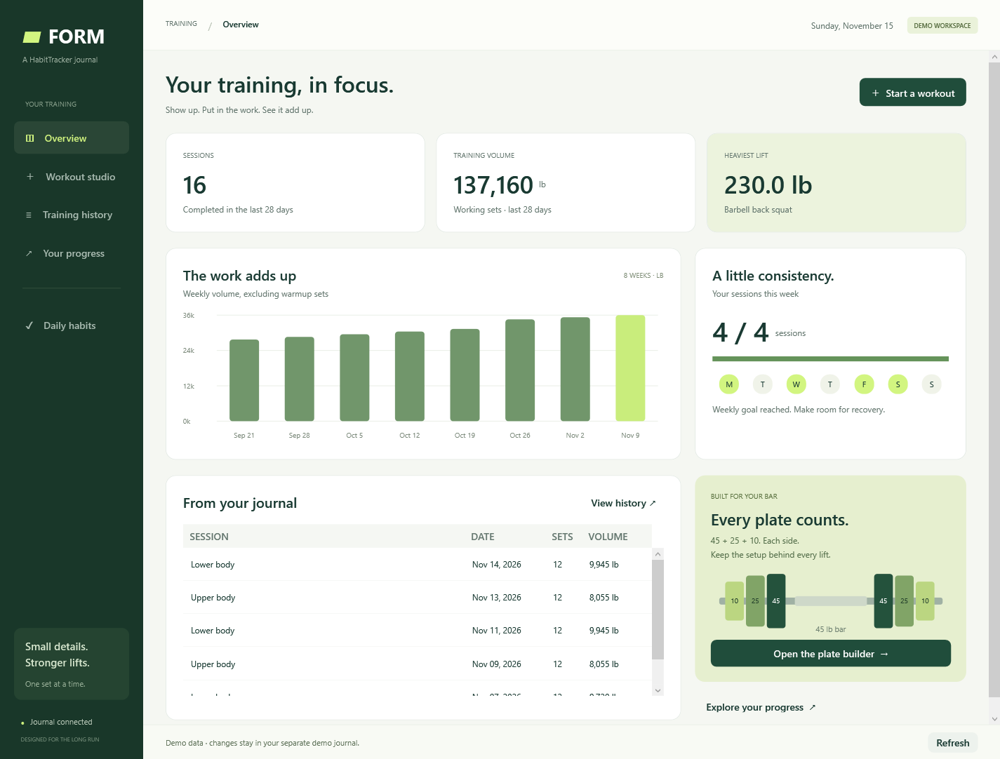
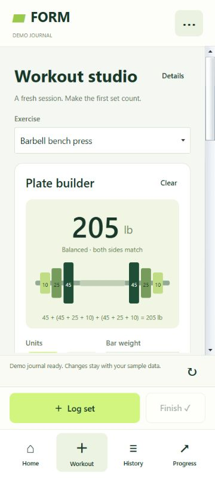
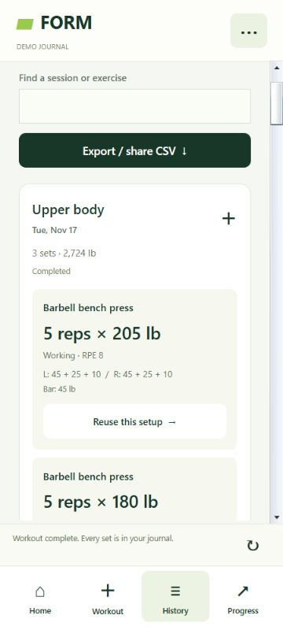
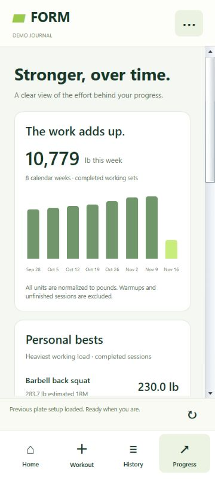
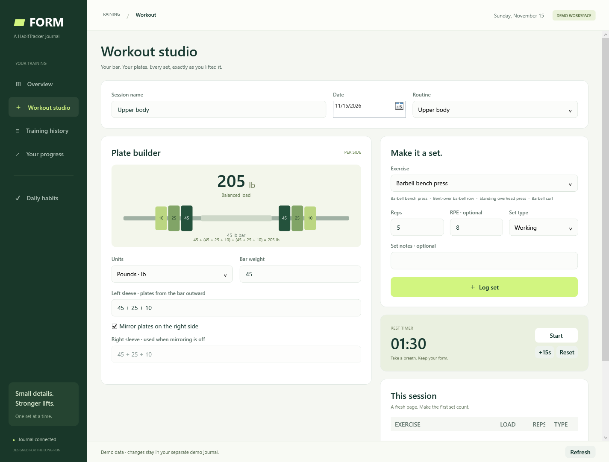
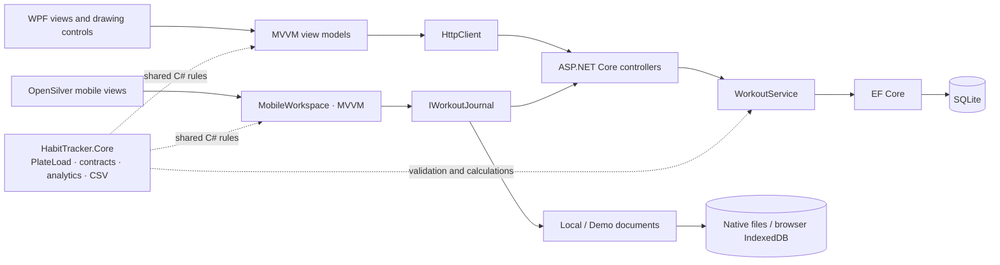
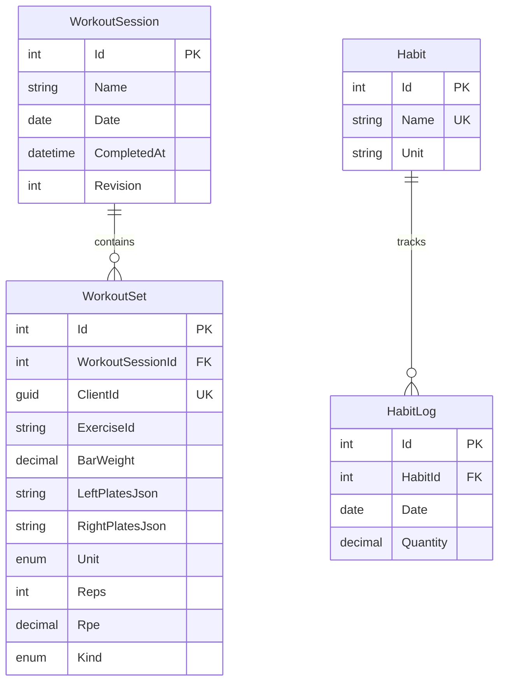

> 本文保留原 HabitTracker / FORM 训练记录业务。当前主产品说明见 [PromptCrew](../README.md)。原应用与数据仍可使用原启动脚本。

# HabitTracker · FORM

**A C# strength journal that remembers the plates, not just the total.**

[](https://github.com/jayhuangsci/HabitTracker/actions/workflows/ci.yml)




## Why I built it

At the gym, I think in plates: **45 lb + 25 lb + 10 lb on each side**. Recording only “205 lb” is realllyyyyy annoying(calculating the weights after a Squart PR attempting?come on). HabitTracker keeps the bar weight, ordered left and right plate stacks, repetitions, effort, and notes together in every set.

```text
45 lb bar + (45 + 25 + 10) left + (45 + 25 + 10) right = 205 lb
```

And another reason is i hate over-complex app with diet logging or gym lessons.

The project grew from a general habit tracker into a focused training application. It demonstrates a complete C# workflow: WPF and OpenSilver mobile interfaces, MVVM state and commands, an ASP.NET Core REST API, EF Core migrations, durable storage, and automated tests.

## Mobile: log every plate from your phone

The new **OpenSilver C#/XAML client** shares the existing plate model and analytics. It has four phone-sized tabs, a live plate builder, persistent unfinished workouts and rest timers, history reuse, progress, habits, and CSV export. Local and Demo journals work independently of the API; Connected mode uses the existing service.

```sh
dotnet workload install wasm-tools
dotnet run --project mobile/HabitTracker.Mobile.Browser
```

Open the [browser demo](http://127.0.0.1:5274/?demo=1), or run `./scripts/Start-Mobile.ps1 -Demo -OpenBrowser` with PowerShell 7. See the [mobile setup and architecture guide](mobile.md) for Android/iOS tooling, exact commands, data behavior and verification.

| Plate builder | History | Progress |
| --- | --- | --- |
|  |  |  |

These are actual browser screenshots at **360 logical px**, using synthetic records. The browser Release build is interactively verified; a standalone **Android Debug APK builds successfully**. Android device behavior and the configured **iOS launcher still need device/Mac validation**. No public preview hosting is configured.

## Try the Windows desktop demo

**Requirements:** Windows 10/11, the [.NET 10 SDK](https://dotnet.microsoft.com/download/dotnet/10.0), and PowerShell 7 or newer for the source scripts.

```powershell
git clone https://github.com/jayhuangsci/HabitTracker.git
cd HabitTracker
.\scripts\Start-Demo.ps1
```

The launcher builds the solution, starts a local API, seeds eight weeks of synthetic workouts, and opens the desktop app. Closing the app stops the API process it started. Sample records persist between demo runs in `.local/demo.db`.

For your own journal, run:

```powershell
.\scripts\Start-App.ps1
```

Personal data uses `src/HabitTracker.Api/habittracker.db`. Existing habit data is retained through an additive migration. Database files, exports under `.local/`, logs, and build artifacts are excluded from new Git commits.

If the default port is occupied, use `-Port 5254` with either launcher. The launchers configure the client automatically. See the [three-minute demo](demo.md) for a guided walkthrough.

## What works today

| Feature | Implemented behavior |
| --- | --- |
| Per-side plate logging | Ordered stacks, custom bar weight, exact `decimal` arithmetic, live total and bar visualization |
| Flexible input | `45lbs+25lbs+10`, fractional plates, empty sleeves, lb/kg, mirrored or independent sides |
| Training sessions | Named and dated sessions, 12 barbell exercises, three starter routines, reps, RPE, warmup/working sets, notes |
| Reliable saves | SQLite persistence, reload unfinished sessions, duplicate client-set protection, optimistic concurrency |
| Rest timer | Starts at 90 seconds after a saved set; pause, resume, add 15 seconds, reset |
| History | Search by session or exercise, inspect exact plate stacks, reuse a saved setup, resume an unfinished session |
| Progress | Eight-week volume chart, 28-day totals, weekly goal, muscle distribution, best loads and estimated 1RM |
| Export | CSV from the UI or API, preserving units and both stacks, with spreadsheet formula escaping |
| Original habits | Create, edit, delete and log general habits; existing habit and statistics endpoints remain available |
| Developer demo | Isolated sample database, API explorer, runnable API demonstration, reproducible screenshots |
| Phone journal | OpenSilver MVVM UI, native file / browser IndexedDB persistence, isolated demo, optional API adapter, platform CSV export |



## Log your first workout

1. Open **Workout studio**, name the session, choose its date and a starter routine.
2. Choose an exercise. Routines list suggested exercises; you select the exercise for each set.
3. Choose units and bar weight. Enter `45 + 25 + 10` in the left sleeve and leave **Mirror** checked for a 205 lb total with a 45 lb bar.
4. Enter repetitions, an optional RPE from 1–10, and optional notes. Choose **Working** or **Warmup**.
5. Select **Log set**. The set is persisted immediately and the rest timer starts. Select a saved set and **Remove selected set** to correct an unfinished workout.
6. Select **Finish workout**. Completed sessions contribute to progress. Use **Training history** to inspect or export them.

Session name and date become fixed after its first save. The most recent unfinished session resumes on startup; older unfinished sessions can be selected in history. Completed sessions are read-only. **Reuse selected setup** copies a historical set into the builder for another set.

### Plate and analytics rules

- A plate expression uses `+` and decimal points. Optional `lb`, `lbs`, or `kg` suffixes must match the selected unit. Empty input means no plates on that sleeve.
- Mirroring copies the entire left stack. Independent sides preserve both stacks; unequal side totals display a warning. “Balanced” refers to equal side totals.
- Changing units loads that unit’s sample setup and standard bar: 45 lb or 20 kg. Existing saved sets retain their original units and plates.
- Working volume is the sum of **total load × reps**. Warmups and unfinished sessions are excluded from progress. Mixed units are normalized to pounds using `1 lb = 0.45359237 kg`.
- Weeks start on Monday. The overview covers the last 28 days; the volume chart shows eight calendar weeks through today. Personal records use all completed sessions through today.
- Estimated 1RM uses the Epley equation for 1–12 reps, with a one-rep set equal to its actual weight. It is a training estimate, not a tested maximum.

## Architecture



The clients and API share contracts and domain calculations. The API validates every set independently and owns connected SQLite persistence; the mobile local adapter validates with the same rules and stores separate device journals. The domain library has no WPF, HTTP, or EF Core dependency. WPF draws its charts and plate visuals directly; OpenSilver uses XAML and Canvas with small browser/device adapters. Neither client needs a third-party charting framework.



Read the [engineering decisions](architecture.md), [database notes](database.md), and [API contract](api.md).

## Build and verify

```powershell
dotnet build HabitTracker.slnx -c Release --warnaserror
dotnet test HabitTracker.slnx -c Release
dotnet tool restore
dotnet ef migrations has-pending-model-changes --project src/HabitTracker.Api
```

The suite contains **49 automated test cases**: 19 domain cases, 9 API cases using real SQLite, 20 mobile persistence/adapter/workspace/timer cases, and one WPF integration case that exercises a persisted workout from creation through history reuse. It also checks that upgrading the original schema preserves habit data.

GitHub Actions runs the complete solution on Windows and the domain/API/mobile-core suites on Linux, checks migration consistency, and produces a self-contained Windows x64 ZIP. The mobile workflow publishes browser files and an Android development APK. High and critical NuGet audit warnings fail restore. OpenSilver hosts build separately from the root solution so desktop reviewers do not need mobile workloads; see [mobile verification](mobile.md#repeat-verification).

For an API-only run on Windows, Linux, or macOS:

```sh
dotnet run --project src/HabitTracker.Api --launch-profile http
```

The development API explorer is at [localhost:5253/swagger](http://localhost:5253/swagger), and readiness is at [localhost:5253/health](http://localhost:5253/health). The desktop URL can also be configured with `HABITTRACKER_API_URL`.

## Package a reviewer demo

```powershell
.\scripts\Publish-App.ps1 -SelfContained
```

This produces `artifacts/HabitTracker-win-x64.zip`, containing the desktop client, API, runtime, and a launcher. Extract it and run `./Run.ps1 -Demo` from PowerShell; no SDK or separate .NET installation is needed. A published package stores its data under `%LOCALAPPDATA%\HabitTracker`, separately from a source checkout. Without `-SelfContained`, both the .NET 10 Desktop Runtime and ASP.NET Core 10 Runtime are required.

Capture the actual app screens with synthetic data:

```powershell
.\scripts\Start-Demo.ps1 -CaptureDirectory docs\images
```

## Project map

```text
HabitTracker/                    WPF client, MVVM, flat theme, drawing controls
src/HabitTracker.Core/           Plate value object, shared contracts, analytics, CSV
src/HabitTracker.Api/            REST API, EF Core entities, migrations, demo seeder
src/HabitTracker.Mobile.Core/    Device journals, API adapter, mobile MVVM, timer
mobile/                         OpenSilver views, browser and Android/iOS launchers
tests/HabitTracker.Core.Tests/   Calculation, parser, unit and CSV tests
tests/HabitTracker.Api.Tests/    HTTP and SQLite migration tests
tests/HabitTracker.Desktop.Tests/ WPF view and persisted command-flow test
tests/HabitTracker.Mobile.Tests/ Device persistence, adapters, recovery and timer tests
scripts/                        Source/demo launchers and Windows packaging
docs/                           Walkthrough, architecture, API, screenshots
```

## Scope and inspiration

This is a single-user application. The API has no authentication and should remain local/private; public or multi-user hosting needs authentication and per-user data isolation. The desktop is Windows-only, while the domain/API and mobile state library are cross-platform. OpenSilver provides a browser preview and MAUI Android/iOS launchers; platform verification limits are documented above. Exercise and routine catalogs are curated C# data; custom catalog editing and automatic cloud sync are outside the current implementation.

The focus on set-level records and simple training analysis is inspired by [Xunji / 训记](https://apps.apple.com/us/app/id1464915553). The per-side plate model, implementation, UI, and assets in this repository are independent.

For interview preparation, see [project talking points and evidence](resume.md).
