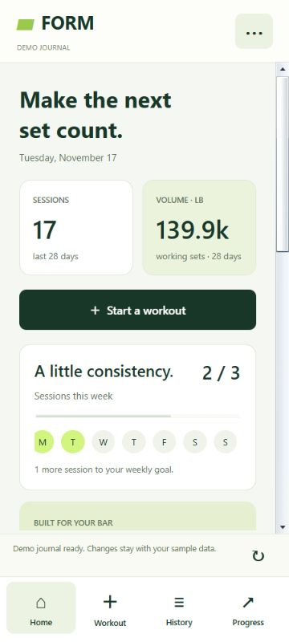
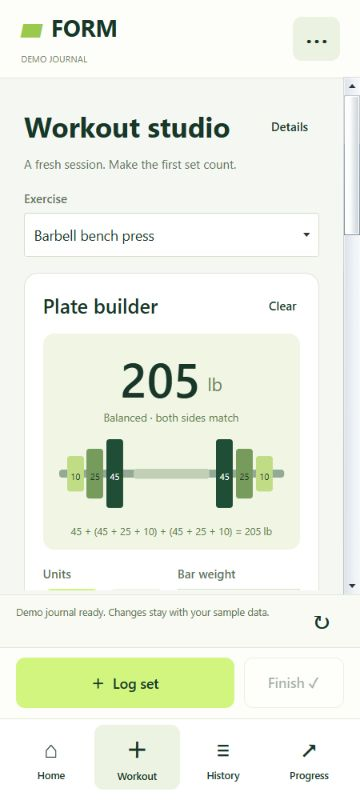
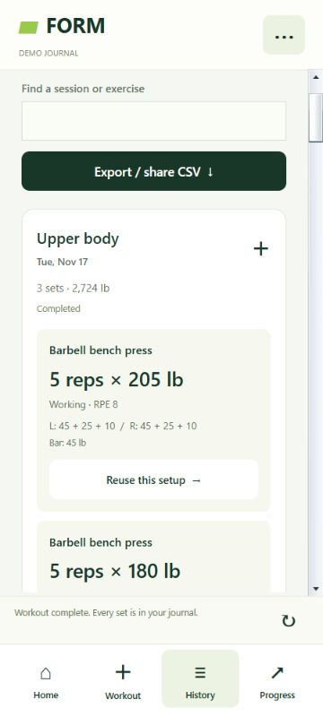
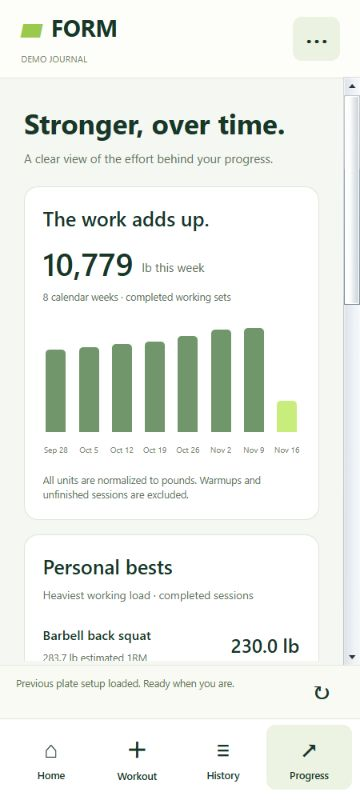
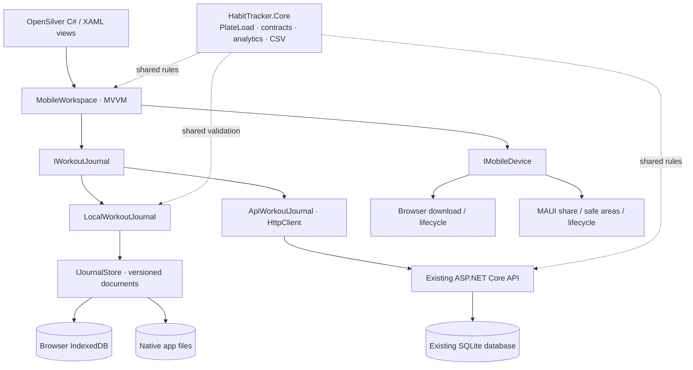

# FORM mobile — OpenSilver + .NET MAUI Hybrid

The same plate calculations power the Windows desktop client, this phone UI, and the API. The mobile interface is C#/XAML with MVVM. OpenSilver renders it in a browser or a MAUI Hybrid WebView; native device storage and CSV sharing are injected at the host boundary.

## Verified status

Validation on **2026-11-17**, Windows x64, .NET SDK **10.0.301**, OpenSilver **3.3.3**:

| Target | Result |
| --- | --- |
| Shared solution | Release build with warnings treated as errors; 49 tests passed: 19 Core, 9 API, 20 Mobile, 1 desktop |
| Browser | Debug build and Release static publish; interactive logging, restart, finish, history reuse, search, CSV, modes and habits checked at 360 logical px |
| Android | Standalone, development-signed Debug APK built with zero warnings; no connected Android device or emulator was available, so installation, native sharing, keyboard and lifecycle behavior have **not** been device-tested |
| iOS | Launcher and platform adapters configured; **not built or run** on this Windows machine. Requires a Mac, compatible Xcode, iOS workload and signing for a physical device |

The screenshots show the actual Release browser UI with synthetic data, not Android or iOS captures.

| Home | Workout |
| --- | --- |
|  |  |

| History | Progress |
| --- | --- |
|  |  |

## Run the browser preview

Install the [.NET 10 SDK](https://dotnet.microsoft.com/download/dotnet/10.0) and its WebAssembly build workload:

```sh
dotnet workload install wasm-tools
dotnet run --project mobile/HabitTracker.Mobile.Browser
```

Open [the local preview](http://127.0.0.1:5274/) for your personal journal, or [the isolated demo](http://127.0.0.1:5274/?demo=1). No API is needed in Local or Demo mode. The launch profile uses port 5274 and does not open a browser automatically.

PowerShell 7 convenience launcher:

```powershell
.\scripts\Start-Mobile.ps1 -Demo -OpenBrowser
# Optional: -Port 5275 -DotNet C:\path\to\dotnet.exe
```

The script uses a project-local SDK at `.local/dotnet/dotnet.exe` when present, otherwise the installed `dotnet`. Install workloads into the SDK you actually use. The optional `?view=Workout`, `?view=History`, and `?view=Progress` parameters open a particular screen. `?demo=1` always chooses Demo on that launch, even if you selected Local in the previous session.

Publish an exportable browser bundle:

```sh
dotnet publish mobile/HabitTracker.Mobile.Browser -c Release -o artifacts/mobile-browser
# Example static server, if Python 3 is installed:
python -m http.server 5274 --bind 127.0.0.1 --directory artifacts/mobile-browser/wwwroot
```

Or run `./scripts/Publish-Mobile.ps1 -Target Browser` to also produce `artifacts/FORM-mobile-browser.zip`. Extract and serve its contents from the web server root. Serve `.wasm` as `application/wasm`; use HTTP/HTTPS, not a file URL. The checked-in HTML base path is `/`. For subdirectory hosting, change it to the deployment path before publishing. No hosting or public API deployment is performed by these scripts.

Browser records are stored in IndexedDB for the **exact origin** (scheme, hostname and port). `localhost` and `127.0.0.1` have separate journals. Clearing site storage removes them. This is a browser preview, without a service worker or installable PWA: loading/reloading the app needs the static server; logging does not require the desktop API. After rebuilding a running development preview, refresh the page; if cached runtime/debug assets are stale, close the old preview tab and reopen it.

## Android

Use a .NET 10-compatible MAUI Android workload, Android SDK and JDK. The validated local toolchain was Android workload **36.1.2**, Android API **36** and Microsoft OpenJDK **17.0.14**. Visual Studio's MAUI workload or Android Studio can supply the SDK/device manager.

```sh
dotnet workload install maui-android
dotnet build mobile/HabitTracker.Mobile.MauiHybrid -f net10.0-android -c Debug
```

If dependencies are missing, the workload includes an installer target. Choose your own SDK/JDK directories:

```powershell
dotnet build mobile/HabitTracker.Mobile.MauiHybrid -t:InstallAndroidDependencies -f net10.0-android "-p:AndroidSdkDirectory=$env:LOCALAPPDATA\Android\Sdk" "-p:JavaSdkDirectory=$env:LOCALAPPDATA\Microsoft\jdk-17" -p:AcceptAndroidSdkLicenses=True
dotnet build mobile/HabitTracker.Mobile.MauiHybrid -f net10.0-android -c Debug "-p:AndroidSdkDirectory=$env:LOCALAPPDATA\Android\Sdk" "-p:JavaSdkDirectory=$env:LOCALAPPDATA\Microsoft\jdk-17"
```

The standalone APK includes managed assemblies (Fast Deployment is disabled). It runs independently of a desktop service in Local/Demo mode. Minimum Android version is **7.0 / API 24**. A compatible Android System WebView is required.

```powershell
.\scripts\Publish-Mobile.ps1 -Target Android
# Optional SDK paths:
# -AndroidSdkDirectory C:\Android\Sdk -JavaSdkDirectory C:\Java\jdk-17
```

This copies the generated APK to `artifacts/FORM-android-debug.apk` and prints its SHA-256 hash. It is development-signed, not a Play Store release.

With an emulator or USB-debugging device already configured:

```sh
adb devices
adb install -r artifacts/FORM-android-debug.apk
```

Alternatively launch from Visual Studio / the MAUI tooling, or use:

```sh
dotnet build mobile/HabitTracker.Mobile.MauiHybrid -t:Run -f net10.0-android -c Debug
```

For multiple attached devices, select the intended device in the IDE or set the documented `AdbTarget` property. Build from a normal local checkout outside OneDrive if Android's cleanup fails with XARDF7024 on read-only synced intermediate directories. SDKs, JDKs, keystores and packages are excluded from Git.

## iOS — requires a Mac

Install a supported Xcode version, complete its setup, and install the .NET 10 MAUI iOS workload. Use the Xcode version required by your installed workload; see the [official iOS requirements](https://learn.microsoft.com/dotnet/maui/ios/cli).

```sh
dotnet workload install maui
dotnet build mobile/HabitTracker.Mobile.MauiHybrid -f net10.0-ios -c Debug -p:RuntimeIdentifier=iossimulator-arm64
dotnet build mobile/HabitTracker.Mobile.MauiHybrid -t:Run -f net10.0-ios -c Debug -p:RuntimeIdentifier=iossimulator-arm64
```

Use `iossimulator-x64` on an Intel Mac. Install the full MAUI workload on macOS because restore evaluates the launcher's declared Android and iOS targets, even when `-f` selects just the iOS build. Minimum iOS version is **15.0**. A physical iPhone build uses `ios-arm64` and requires an Apple signing identity and provisioning profile configured in the IDE. Keep signing secrets out of the repository.

iOS uses `TrimMode=copy` to preserve reflection-based XAML bindings while allowing Apple's required linker pipeline to run. Safe-area handling, native file sharing and resume/background callbacks are configured, but they still require real iOS validation. App Store packaging and distribution are outside this development build.

## Connect to the existing API

Local, Demo and Connected are separate journal sources. Connected mode uses the existing workout/habit endpoints; it does **not** upload, merge or synchronize a device journal.

1. Start your existing API with `dotnet run --project src/HabitTracker.Api --launch-profile http`.
2. Open **⋯ Settings → Journal → Connected · existing API**.
3. Enter the full base URL and select **Open selected journal**.
4. If the server cannot be reached, the previous journal stays open. Retry a pending set or refresh after an uncertain save; the original client-set GUID prevents adding it twice.

| Client | Address of an API on the development computer |
| --- | --- |
| Browser on that computer | `http://localhost:5253/` |
| Android emulator, Debug build | `http://10.0.2.2:5253/` |
| USB Android phone, Debug build | Run `adb reverse tcp:5253 tcp:5253`, then use `http://127.0.0.1:5253/` on the phone |
| iOS simulator | Host is the Mac, not Windows; use a reachable HTTPS URL with a valid trusted certificate |
| Physical phone over Wi-Fi | A reachable HTTPS address with a trusted certificate; configure server/firewall access intentionally |

Android Debug permits HTTP only for `10.0.2.2`, `127.0.0.1` and `localhost` through a scoped network configuration. Release uses the platform HTTPS policy. iOS ATS stays enabled; no certificate-validation bypass is included. For networking details, see [Microsoft's local-service guide](https://learn.microsoft.com/dotnet/maui/data-cloud/local-web-services).

The API's browser CORS policy allows `http://127.0.0.1:5274` and `http://localhost:5274` by default. For another preview origin, configure it explicitly when starting the API:

```powershell
$env:MobileClients__AllowedOrigins__0 = 'http://127.0.0.1:5275'
dotnet run --project src/HabitTracker.Api --launch-profile http
```

CORS applies to the browser client. Native API requests use .NET HttpClient. An HTTPS browser cannot call an HTTP API because of mixed-content restrictions. The existing API has no authentication or per-user isolation; keep it local/private. Public or multi-user hosting requires that additional work.

## Use the app

- **Home:** start/resume your training, pick a routine, inspect the last 28 days and this week's goal.
- **Workout:** open **Details** to name/date a session and select its routine. Choose an exercise, bar, units, and plates. Enter reps, optional RPE, type and notes; tap the fixed **Log set** button. Each set saves immediately. Session name/date are fixed after the first save.
- **Plate builder:** type `45lbs+25lbs+10` or tap chips. Chips follow sleeve order from the bar outward; tap a plate's × to remove that occurrence. Mirror copies the left expression and stack. Turn it off to edit the right side. Unequal side totals display a warning. **Clear** empties both sleeves, retaining the bar. Changing units loads the corresponding sample setup rather than converting the builder in place.
- **Correction:** remove an incorrect set from the active session and log its replacement. Completed sessions are read-only.
- **Rest:** every confirmed set starts 90 seconds. Pause/start, add 15 seconds or reset. Running state stores a UTC deadline, so background time counts and restart restores the remaining time; a paused timer stays paused.
- **Finish:** the fixed Finish button completes a session. Completed working sets appear in Progress; warmups and unfinished sessions do not.
- **History:** search by session or exercise, expand a card, inspect the bar and both ordered stacks, reuse a setup or resume an unfinished session. Reuse copies the configuration, reps, RPE, type and notes without changing the original.
- **Progress:** eight calendar weeks of volume, all-time heaviest loads and estimated 1RMs, last-28-day muscle distribution, and a 1–7-session weekly goal. Mixed units use the shared conversion factor `1 lb = 0.45359237 kg`; Epley estimates use 1–12 reps.
- **Daily habits:** open **⋯ → Daily habits**. Create/edit a habit, log a quantity for a date, update that date by saving again, or remove records. Deleting a habit requires a confirmation and removes its logs.
- **CSV:** History or Settings exports all sets in the active journal, including unfinished sessions and warmups, with a Status/Kind column. Browser download and native share preserve original units and stacks; unsafe spreadsheet formula prefixes are escaped. CSV is an export, not a round-trip backup/import format.

## Data and recovery

| Source | Saved records | Workspace recovery |
| --- | --- | --- |
| Local native | Versioned JSON documents in MAUI AppDataDirectory/journals; atomic same-directory replacement with a file lease | Separate workspace document with draft, active session, pending client-set ID and timer |
| Local browser | IndexedDB transactions with compare-and-swap document versions | Separate workspace key on the same origin |
| Demo | Separate persistent documents seeded once with 56 days / 32 synthetic sessions and sample habits | Independent draft and timer; demo edits persist, without reseeding on every visit |
| Connected | Existing API SQLite database | Device workspace keyed by normalized API address; saved records are reloaded from the API |

An unfinished session is recovered on startup. Older unfinished sessions can be resumed from History. An ambiguous set save keeps its original GUID and freezes the draft until the save is confirmed. Local record mutations retry version conflicts against the newest snapshot, preventing two windows from silently overwriting each other's journal entries. A draft is debounced by 300 ms and flushed during the supported lifecycle callbacks. Records themselves are committed by each logging action. Avoid editing the same draft concurrently in multiple tabs; drafts use last-writer-wins semantics.

Unreadable or newer-schema journals are retained and reported rather than automatically reset. Device files are not application-encrypted; browser storage follows the browser profile. Uninstalling the native app or clearing browser storage removes local records; keep exported copies if you need them. No cloud account, automatic sync, background network queue or CSV import is implemented.

## Architecture



```mermaid
sequenceDiagram
    participant U as Workout screen
    participant V as MobileWorkspace
    participant D as Device workspace
    participant J as Journal adapter
    U->>V: Log set
    V->>D: Persist draft + pending GUID
    V->>J: Save original bar / stacks / reps / GUID
    alt Confirmed or GUID already exists
        J-->>V: Saved workout
        V->>D: Clear pending + save 90-second deadline
        V-->>U: Set saved
    else Confirmation interrupted
        V-->>U: Retain pending set; offer retry / refresh
        U->>V: Restart or refresh
        V->>J: Reload and reconcile original GUID
    end
```

`src/HabitTracker.Mobile.Core` contains persistence, adapters, commands, presentation state and timer logic without a UI dependency. `mobile/HabitTracker.Mobile` owns XAML, Canvas barbell drawing, converters and browser interop. The Browser and MauiHybrid projects are launchers. JavaScript is limited to IndexedDB, browser export, DOM accessibility and viewport/lifecycle integration.

The root `HabitTracker.slnx` includes the platform-independent Mobile.Core/tests alongside the original application. The exportable `mobile/HabitTracker.Mobile.sln` includes the OpenSilver launchers. Build hosts individually when only one workload is installed. The generated Windows simulator is optional and was not used for the documented verification.

## Repeat verification

```sh
dotnet build HabitTracker.slnx -c Release --warnaserror
dotnet test HabitTracker.slnx -c Release --no-build
dotnet publish mobile/HabitTracker.Mobile.Browser -c Release -o artifacts/mobile-browser
dotnet build mobile/HabitTracker.Mobile.MauiHybrid -f net10.0-android -c Debug
```

On Linux/macOS, run the cross-platform suites independently instead of the WPF solution:

```sh
dotnet test tests/HabitTracker.Core.Tests -c Release
dotnet test tests/HabitTracker.Api.Tests -c Release
dotnet test tests/HabitTracker.Mobile.Tests -c Release
```

Mobile tests cover the three exact plate examples, durable file reloads, version conflicts, duplicate saves, unfinished recovery, historical reuse, isolated demo/preferences, malformed/newer data retention, habits, deadline/pause behavior, ambiguous-save recovery, the real API adapter and the allowed/denied CORS origins. The existing Core suite checks invalid plate expressions, analytics, unit conversion and CSV escaping.

GitHub Actions retains the desktop/API checks and adds Mobile.Core tests, browser publishing, and a standalone Android APK artifact. iOS CI and physical-device automation are not configured. Large-journal pagination, screen-reader behavior, large text, soft-keyboard resizing and native share/background recovery need device coverage before a production release.

The recorded browser walkthrough saved **205 lb**, **180 lb** and **72.5 kg**, reloaded the unfinished three-set workout, completed it, searched/expanded history, reused 205 lb, and downloaded a **387-row** synthetic CSV (384 seeded sets plus those three). These are verification observations, not performance benchmarks.

Implementation references: [OpenSilver MAUI Hybrid](https://doc.opensilver.net/documentation/general/maui-hybrid-launcher.html), [OpenSilver JavaScript interop](https://doc.opensilver.net/documentation/general/javascript-interop-and-libraries.html), [Android dependency setup](https://learn.microsoft.com/dotnet/android/getting-started/installation/dependencies), and [iOS linker properties](https://github.com/dotnet/macios/blob/main/docs/building-apps/build-properties.md).
