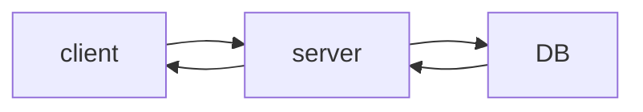

# habitTracker app dev

## overall functions

- user input their habit,e.g "i run 5 KM today".The app can store date,unit,quantity,comments or other attributes

- user can initialize habit they try to track,user define what is the attributes of that habit

- user can add/delete/modify/query everything of  habits

  

## Overall depolyment 

The there layers can be designed seperately,which means they dont rely on each other

The client can be easily changed base on APIs provided by server.

### client

using MVVM 

model - view -viewModel

### server,DB

dunno

## Overall code style priciple

- SOLID principle
- Comments if necessary
- 

### SE method

Agile software development
we set the submit period as short as possible(under 1 week)

Sprint and keep it going