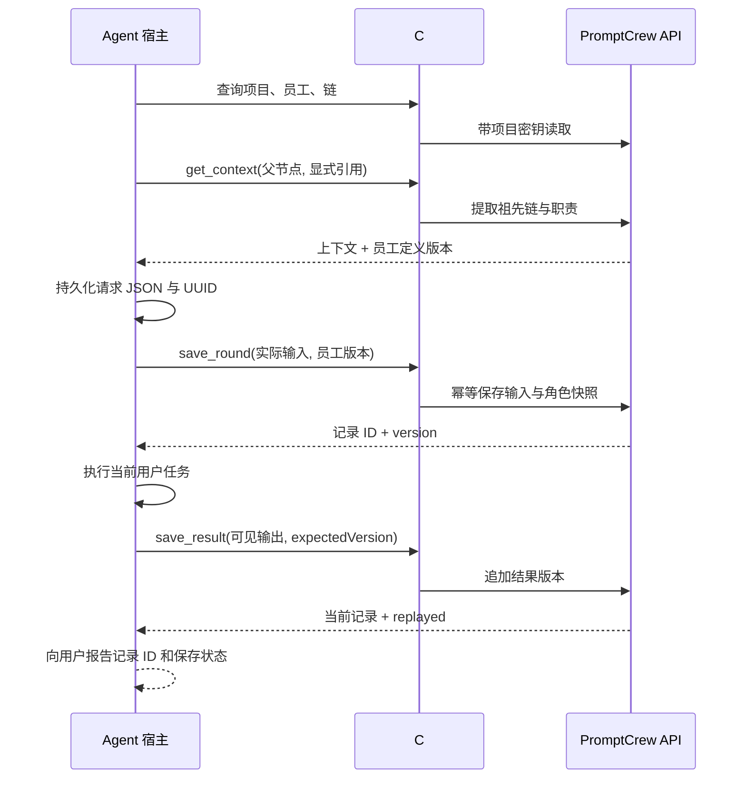

# Agent 与 Skill 接入

本阶段实现 **HTTP 工具适配**。C# 程序 `PromptCrew.Tools` 把 JSON 函数参数变成经过认证的 API 调用；Skill 规定如何读取上下文、保存实际输入、追加结果并报告记录 ID。它不会自动启动模型或产生推理费用。

## 本地宿主配置

1. 通过 `./scripts/Start-PromptCrew.ps1` 启动桌面与 API。
2. 在“API Key”界面选择项目，签发 Agent 密钥并保存到仓库外。管理员密钥可用于初始配置，日常 Agent 使用项目密钥。
3. 在运行 Agent 的同一宿主环境设置以下变量。桌面启动器子进程中的变量不会自动传播到另一个终端。
4. 注册函数或让有 shell 权限的 Agent 调用命令。

```powershell
$env:PROMPTCREW_API_URL = 'http://127.0.0.1:5283/'
$env:PROMPTCREW_KEY_FILE = 'C:/my-secrets/promptcrew-agent.key'
$env:PROMPTCREW_TOOLS_DLL = (Resolve-Path 'src/PromptCrew.Tools/bin/Release/net10.0/PromptCrew.Tools.dll').Path

New-Item -ItemType Directory .local -Force | Out-Null
'{"operation":"list_projects"}' | Set-Content .local/projects.json -Encoding utf8NoBOM
dotnet $env:PROMPTCREW_TOOLS_DLL invoke .local/projects.json
```

Linux/macOS 可在 API 同机运行 `dotnet build src/PromptCrew.Tools -c Release`，然后设置相同环境变量并执行 DLL。源码调用需要 .NET 10 SDK 构建；运行已构建 DLL 需要 .NET 10 Runtime。Windows 自包含包提供可直接执行的 `tools/PromptCrew.Tools.exe`。

## 安装 Skill

仓库包位于 `skills/promptcrew-journal`。在 Codex 中，将这个目录复制到个人 Skills 目录；其他宿主按其支持的 Skills 目录放置。

```powershell
$destination = Join-Path $env:USERPROFILE '.codex/skills/promptcrew-journal'
# 首次安装；若目录已存在，请先核对已有版本再更新。
Copy-Item -LiteralPath skills/promptcrew-journal -Destination $destination -Recurse
```

安装后配置绝对路径 `PROMPTCREW_TOOLS_DLL`；仓库外的 Skill 不再能通过相对路径定位源码构建产物。让宿主重新发现 Skill 后，可以说：

> 使用 promptcrew-journal，在“星港”项目中让程序员接手当前即时制分支，保存本轮输入；完成后把输出与成果路径归档，返回记录 ID。

用户指定的项目与分支应优先采用。当前对象不明确时，Agent 先通过工具查询，必要时询问。它只归档当前任务可见业务内容，不读取模型隐藏推理或平台系统指令。

## 函数调用宿主怎样接线

`tools/promptcrew.function.json` 是通用函数定义，不是 MCP 配置。宿主收到名为 `promptcrew` 的调用后：

1. 解析参数，生成仅用于该调用的本地 JSON 文件。
2. 将参数原样写入文件；写入类操作的 `body.clientRequestId` 只生成一次。
3. 使用参数数组运行 `dotnet <绝对 DLL 路径> invoke <绝对请求路径>`，不经字符串拼接的 shell。
4. 解析 stdout JSON 并作为工具结果返回。退出码 0 成功、1 操作失败、2 用法错误。
5. 保存失败保留请求文件。工具失败响应含请求 ID 和文件位置；重试执行原文件。

宿主负责接收模型的 function call、把结果交还模型和保护凭据。本仓库没有内置特定提供商的模型循环、MCP server 或云端模型连接。

工具允许的操作与 API 一一映射，包括目录查询/创建/更新、save_round、save_result、get_context、get_graph、get_by_request、search_rounds 和 compare_rounds。参数与载荷见 [Skill 工具约定](../skills/promptcrew-journal/references/tool-contract.md) 和 [HTTP API](promptcrew-api.md)。不接受来自模型参数的任意 URL 或密钥；共享客户端不跟随重定向。

## 一轮任务的顺序



新发现的成果路径可以放在结果 `artifacts` 中；跨链轮次作为输入上下文使用时，先放 `referenceIds` 获取，再在保存中放 `referenceRoundIds`。引用不会自动下载文件。

## 云端 Agent 如何访问

云端进程的 `localhost` 指向云端自身，不能直接访问用户电脑。选择一种可达方式：

- **同一受控主机运行 API 和工具**：API 使用持久数据目录，工具连接主机内的环回地址。
- **受控网络中的远程 API**：由部署者提供可信 HTTPS 域名、反向代理和网络访问控制，把服务转发到内部 API；Agent 宿主从凭据存储注入项目密钥。
- **私有网络或受控转发**：确保 Agent 运行环境确实能路由到服务地址，并使用 HTTPS；保持项目范围密钥。

远程 API 可以用 `dotnet publish src/PromptCrew.Api -c Release -o <目录>` 部署，配置 `PromptCrew__DataDirectory`、`PromptCrew__AdminKeyFile` 和内部 `ASPNETCORE_URLS`。默认服务仅绑定本机。此仓库没有创建公开地址或自动配置隧道；云端网络与 HTTPS 部署需要宿主提供。

密钥属于持久访问凭据，保存在受控文件或宿主凭据存储中，勿发送给模型作为提示词内容。项目密钥可在桌面撤销；管理员密钥轮换需要更新文件并重启服务。数据库和本机草稿为明文业务数据，依赖操作系统访问权限。

## 验证

`./scripts/Test-PromptCrewAgent.ps1` 启动独立本机服务，以管理员创建项目，再切换为项目范围密钥，经真实 CLI/HTTP 建立四名员工、六轮交接和分支。它验证原请求重放、不同内容冲突、祖先链与显式引用边界；请求文件和总结留在 `.local/agent-check-<UUID>/`，不修改正式数据，也不调用任何付费模型。

