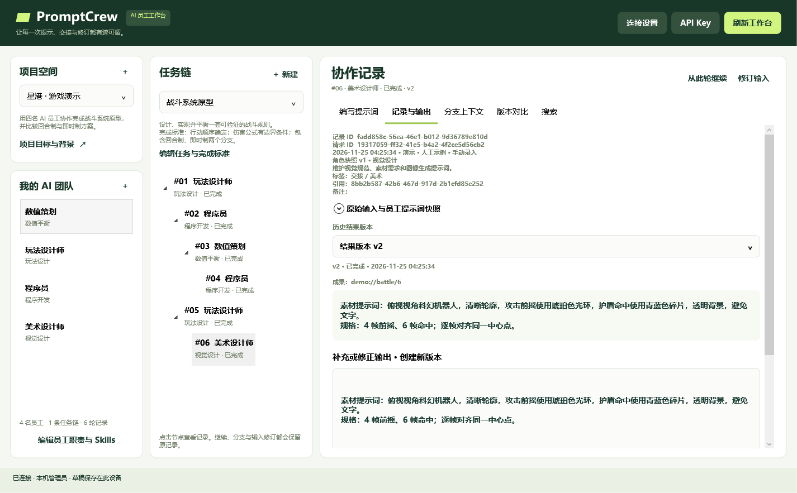

# 游戏项目验收

## 桌面体验

运行 `./scripts/Start-PromptCrew.ps1 -Demo`。该命令只使用 `.local/promptcrew-demo`，首次为空时才加入示例，不会每次重复生成记录。

1. 项目“星港 · 游戏演示”包含玩法设计师、程序员、美术设计师、数值策划四名员工。
2. 展开“战斗系统原型”：01 设计 → 02 程序 → 03 数值 → 04 程序修正，另有 01 → 05 即时制 → 06 美术。
3. 选择 04，在“记录与输出”切换结果版本，查看补充前后的变化。
4. 选择 01，点击“从此轮继续”，切换程序员，写入新方案并保存。检查新节点的父节点为 01。
5. 打开“分支上下文”，点击生成；核对包含祖先和明确引用，没有自动加入全部分支。
6. 点击“修订输入”，修改正文并保存。原记录仍能打开，新记录带 revisesRoundId；在“版本对比”比较。
7. 输入尚未保存的草稿，关闭应用再运行。检查项目、链和草稿恢复。正式保存的记录保存在独立 SQLite 中。



## 真实 Agent 工具链

```powershell
./scripts/Test-PromptCrewAgent.ps1
```

脚本构建并启动独立 API，默认使用 5284 端口。它经工具创建项目，签发项目范围的密钥，再用该密钥执行后续工具调用：

- 创建四名员工与战斗系统任务链。
- 每步先获取上下文，再保存实际示例输入，最后补充可见结果。
- 玩法 → 程序 → 数值 → 程序的主链，以及同一根节点分出的即时制 → 美术分支。
- 重新提交第一轮原文件，确认同一 ID；更改正文再提交，确认 409。
- 在即时制分支明确引用数值评估，确认上下文没有带入未引用的回合制程序节点。
- 查询图，核对六个节点和父子关系。

成功输出 `ok: true`、4 名员工、6 轮记录和验证项。全部请求 JSON、数据库、密钥与总结留在独立 `.local/agent-check-<UUID>` 中，密钥不会写入总结或版本控制。完成后服务停止；需要继续看该库，可把 API 的数据目录和管理员密钥文件配置到该目录再启动。

示例使用人工编写的业务内容，不调用真实模型。一次完整流程以真实 CLI/HTTP 完成，适合展示与回归验证；API 的并发与隔离由集成测试另行验证。

