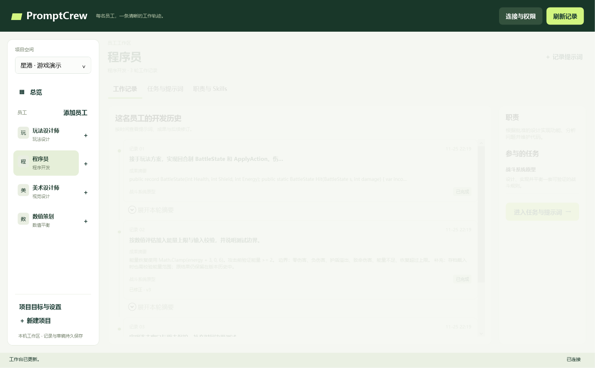

# 游戏项目验收

## 桌面体验

便携版解压完整 ZIP 后双击 `PromptCrew-Demo.exe`；正式项目使用 `PromptCrew.exe`。源码可双击根目录的 `Start-PromptCrew-Demo.cmd`，启动器兼容系统 Windows PowerShell 5.1。

首次创建的演示包含四名员工，每人三轮工作，共 12 轮持久化记录。已有演示不会自动追加样例；验证截图使用独立新建的演示库。

1. 默认“总览”按员工分别展示历史：玩法设计、程序、美术、数值各自一列。卡片的纵向连线表示该员工的时间顺序。
2. 点击左侧“程序员”，查看他的三轮工作与参与任务；在“职责与 Skills”查看当前配置。
3. 点击历史卡片，进入“任务与提示词 → 记录与输出”，阅读完整原始提示词、员工快照和输出。记录信息中的父节点和引用仍是实际任务关系。
4. 点击“查看本轮祖先与引用”，核对所选轮次的上下文。编写区生成的上下文则使用草稿父节点与明确引用。
5. 在任务树选择程序修正记录 04，通过“版本对比”选择同一轮的 v2/v3，查看补充前后差异。
6. 从历史节点继续工作，或修订输入生成新轮次；回到总览查看更新后的对应员工卡片。
7. 滚动总览后打开卡片，再返回“总览”，检查浏览位置恢复。分别为两名员工输入草稿，切换与重启后检查各自内容保留。
8. 切换空项目，确认没有带入其他项目的员工或历史。





## 真实 Agent 工具链

```powershell
./scripts/Test-PromptCrewAgent.ps1
```

脚本构建并启动独立 API，默认使用 5284 端口。它经工具创建项目，签发项目范围的密钥，再用该密钥执行后续工具调用：

- 创建四名员工与战斗系统任务链。
- 每步先获取上下文，再保存实际示例输入，最后补充可见结果。
- 玩法 → 程序 → 数值 → 程序的主链，以及同一根节点分出的即时制 → 美术分支。
- 重新提交第一轮原文件，确认同一 ID；更改正文再提交，确认 409。
- 为程序修正追加输出，并通过工具直接比较同一轮的 v2/v3。
- 在即时制分支明确引用数值评估，确认上下文没有带入未引用的回合制程序节点。
- 查询图，核对六个节点和父子关系。

成功输出 `ok: true`、4 名员工、6 轮记录和验证项。全部请求 JSON、数据库、密钥与总结留在独立 `.local/agent-check-<UUID>` 中，密钥不会写入总结或版本控制。完成后服务停止；需要继续看该库，可把 API 的数据目录和管理员密钥文件配置到该目录再启动。

示例使用人工编写的业务内容，不调用真实模型。一次完整流程以真实 CLI/HTTP 完成，适合展示与回归验证；API 的并发与隔离由集成测试另行验证。


新交互完整演示：点击员工旁 `+`，同面板输入/新建任务，保存后历史立即更新。真实三步截图、快捷键及网络恢复见 [desktop guide](promptcrew-desktop-guide.md)。当前 Agent 验证共34次CLI/HTTP调用，增加任务创建重试与员工历史分页检查。
