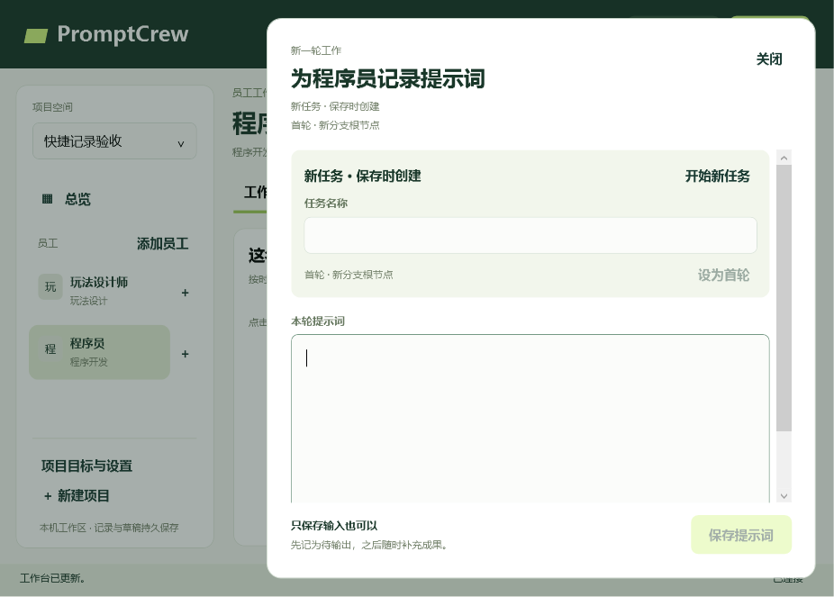
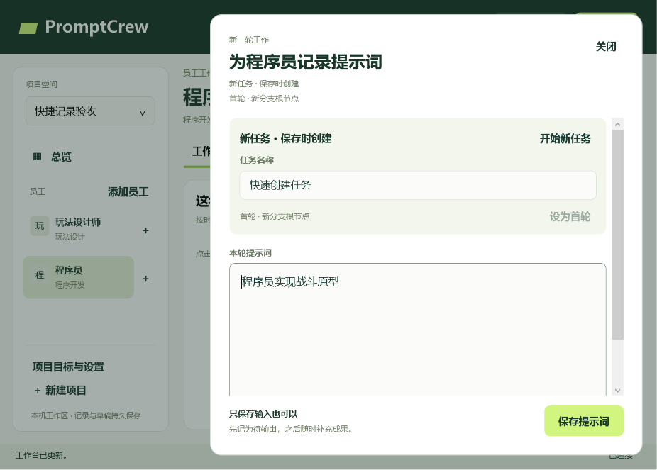
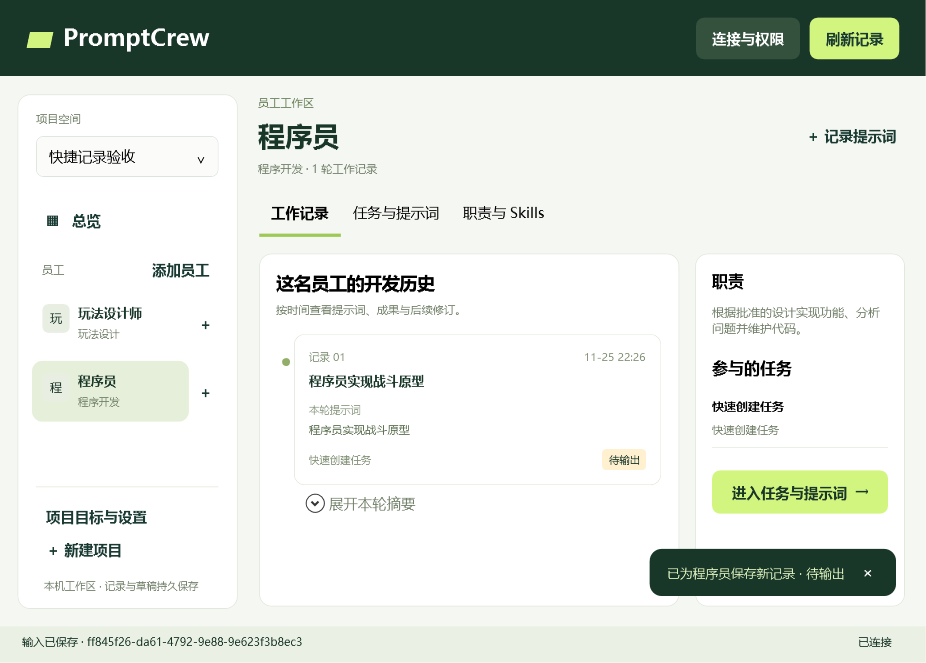

# Desktop quick capture and connection guide

The application uses Chinese labels. This guide supplies English explanations. Start `PromptCrew-Demo.exe` for the isolated game demo or `PromptCrew.exe` for personal work. Keep all companion folders beside the executable.

## Record a prompt in three steps

1. Click **+** beside the employee in the left sidebar. Its tooltip is **为该员工记录提示词**. **添加员工** creates an employee separately.
2. Type the actual prompt. The header identifies the employee, task, and actual parent. An existing task is reused; the task selector switches to another draft. **开始新任务** opens an inline task-name field. **设为首轮** starts a new root within the selected task.
3. Click **保存提示词**, or press **Ctrl+Enter**. A confirmation appears and the new card enters that employee's history as **待输出**. Open the card later to append output and inspect prior versions.

These are captures of an actual WPF window using an isolated SQLite database and HTTP service. The workflow test invokes the displayed buttons' real commands, double-clicks Save, and checks that exactly one task and one round exist. It then tests failed saves and reopening the persisted draft.

For an explicit historical branch, open its card and select **从此轮继续**. That record is the parent. The overview's connecting lines describe each employee's chronological history; they never determine a task parent or introduce cross-task parent links.

Model, tags, references, and notes live under **高级选项**. Closing with **关闭** or **Esc** keeps the local draft. Staff and task changes have isolated drafts. Original input and employee snapshots are preserved; editing an old input creates another round, and output corrections append versions.

## Read longer histories

Each employee column has its own vertical scroll. The project overview scrolls horizontally when the team exceeds the window width. **展开本轮摘要** reveals bounded previews; click the card for full text and versions.

The first page contains the latest 50 records, displayed from older to newer. **加载更早记录** uses a timestamp/ID cursor, so new records from another client do not move the continuation. Refresh retrieves newly added records. Task participation includes older work outside the loaded pages.

The minimum window is 920×660. The composer keeps its header/footer available and scrolls its form; narrow task details scroll horizontally. Under **连接与权限 → 减少动画**, disable the 180 ms reveals. This preference persists, and the app also respects the operating system's animation setting.

## Connect a service

Open **连接与权限 → 连接设置**:

- **API 根地址**: use a loopback address such as `http://127.0.0.1:5283/` locally, or an HTTPS API root remotely. The client rejects embedded credentials, query strings, fragments, and remote plain HTTP.
- **项目密钥文件**: choose the file supplied by the operator. Settings store the path, not the key value. Use a key scoped to the intended projects for Agent work.
- **请求超时**: choose 1–120 seconds; default 20.
- **测试连接** validates the address and current session without saving configuration. **验证并保存** validates, loads the workspace, and saves. Canceling or failing that change restores the previous client, workspace, and permission state.

The footer shows connection and operation status. **取消** stops an active operation. During a quick save the composer provides its own **取消操作** button. Canceling a read restores the last coherent workspace; superseded employee/project requests cannot apply stale results.

| Feedback | Action |
| --- | --- |
| Service unavailable | Start the local service, or check the remote address/network |
| Address cannot be resolved / invalid data | Correct the API root; use a PromptCrew endpoint |
| Timeout | Check the network and timeout, then reconcile pending writes |
| Authentication failed (401) | Choose a valid key file |
| Forbidden project (403) | Obtain a key with access to that project |
| Version or definition conflict (409) | Compare current data before preparing a changed request |

## Recover a pending save

The app persists the exact request and ID before sending it. On failure or cancellation, the form stays intact. **检查保存状态** looks for the original round/result. If found, the app confirms success; otherwise, retry uses the same payload and ID. A 404 alone cannot prove that an earlier in-flight write will never commit.

**编辑未保存的草稿** is enabled only when the first attempt was definitively rejected, with no prior uncertain attempt. It preserves the visible draft and allows an intentional corrected request. An uncertain request is never automatically replaced by a new ID, including after restart. New inline tasks follow the same rule and retain their creation IDs.

If an uncertain write later conflicts and cannot be found, leave its ID intact and ask the service operator to reconcile it. The application deliberately keeps that case frozen rather than risking a duplicate. Local drafts are single-window files; multiple windows do not merge concurrent file edits.

## Agent tools

Set `PROMPTCREW_API_URL`, `PROMPTCREW_KEY_FILE`, and optionally `PROMPTCREW_TIMEOUT_SECONDS`. Use the packaged `tools/PromptCrew.Tools.exe invoke request.json`; Ctrl+C cancels a call. Errors return JSON and retain the request file/ID. Consult the [Skill](../skills/promptcrew-journal/SKILL.md) and [API guide](promptcrew-api.md) for exact payloads and cursor continuation.
